# Systems & Concurrency Deep Dive: Building SeatRush

> **A Systems Engineering Masterclass in High-Contention Inventory Allocation**  
> *Case Study: 1,000 Customers Competing for 100 Seats in Real Time*

---

## Table of Contents
1. [The Concurrency Problem in Inventory Systems](#1-the-concurrency-problem-in-inventory-systems)
   - [The Physical Reality: The Thundering Herd at Seat A7](#the-physical-reality-the-thundering-herd-at-seat-a7)
   - [Why Naive "Check-Then-Act" Fails (TOCTOU & Lost Updates)](#why-naive-check-then-act-fails-toctou--lost-updates)
   - [The Double-Allocation Failure Mode](#the-double-allocation-failure-mode)
   - [Visualizing the Race: Naive TOCTOU vs. Pessimistic Serialization](#visualizing-the-race-naive-toctou-vs-pessimistic-serialization)
2. [PostgreSQL MVCC & Isolation Levels](#2-postgresql-mvcc--isolation-levels)
   - [Multi-Version Concurrency Control (MVCC) Mechanics](#multi-version-concurrency-control-mvcc-mechanics)
   - [Read Committed vs. Serializable: The Abort Storm Dilemma](#read-committed-vs-serializable-the-abort-storm-dilemma)
   - [Row-Level Lock Modes: `FOR UPDATE` vs. `FOR NO KEY UPDATE` vs. `FOR KEY SHARE`](#row-level-lock-modes-for-update-vs-for-no-key-update-vs-for-key-share)
   - [Why `FOR NO KEY UPDATE` Was Essential for `claim_seats`](#why-for-no-key-update-was-essential-for-claim_seats)
3. [Deadlock Prevention via Strict Resource Ordering](#3-deadlock-prevention-via-strict-resource-ordering)
   - [Anatomy of a Deadlock: Ordering Inversion](#anatomy-of-a-deadlock-ordering-inversion)
   - [SeatRush's Total Lock Hierarchy (ADR 0001)](#seatrushs-total-lock-hierarchy-adr-0001)
   - [Deterministic ID Sorting in `claim_seats`](#deterministic-id-sorting-in-claim_seats)
4. [All-or-Nothing Atomicity in SQL](#4-all-or-nothing-atomicity-in-sql)
   - [The Multi-Seat Partial Allocation Trap](#the-multi-seat-partial-allocation-trap)
   - [Step-by-Step Breakdown of `claim_seats(...)`](#step-by-step-breakdown-of-claim_seats)
   - [Conditional CTE Updates and `SR409` Conflict Signaling](#conditional-cte-updates-and-sr409-conflict-signaling)
5. [Database Invariants & Defensive Constraints](#5-database-invariants--defensive-constraints)
   - [Relational Schema & Entity Relationships](#relational-schema--entity-relationships)
   - [The Immutable Hold Clock: `CHECK` + `BEFORE INSERT/UPDATE` Triggers](#the-immutable-hold-clock-check--before-insertupdate-triggers)
   - [Temporal Exclusion Constraints: `EXCLUDE USING gist`](#temporal-exclusion-constraints-exclude-using-gist)
   - [Deferred Integrity Constraints: `assert_hold_integrity`](#deferred-integrity-constraints-assert_hold_integrity)
6. [State Machines & Absorbing States](#6-state-machines--absorbing-states)
   - [The Hold Lifecycle & Self-Expiring Reads](#the-hold-lifecycle--self-expiring-reads)
   - [The PaymentAttempt Lifecycle & Absorbing Terminal States](#the-paymentattempt-lifecycle--absorbing-terminal-states)
   - [The Race Condition: Payment Success vs. Hold Expiry (FR-05)](#the-race-condition-payment-success-vs-hold-expiry-fr-05)
   - [The Two-Phase Refund Recovery Loop](#the-two-phase-refund-recovery-loop)
7. [The Transactional Outbox Pattern & Event Ordering](#7-the-transactional-outbox-pattern--event-ordering)
   - [The Dual-Write Hazard: Ghost Bookings & Lost Events](#the-dual-write-hazard-ghost-bookings--lost-events)
   - [Transactional Outbox Architecture](#transactional-outbox-architecture)
   - [The Sequence Cursor Pattern: `screening_event_cursors`](#the-sequence-cursor-pattern-screening_event_cursors)
8. [Idempotency & Fencing](#8-idempotency--fencing)
   - [The Network Boundary: Retries and Ghost Executions](#the-network-boundary-retries-and-ghost-executions)
   - [Canonical Request Hashing](#canonical-request-hashing)
   - [Two-Phase Fenced Leases (`locked_until` & Fencing Tokens)](#two-phase-fenced-leases-locked_until--fencing-tokens)
   - [Savepoints & 4xx Conflict Retention](#savepoints--4xx-conflict-retention)
9. [Visual System Architecture & Mermaid Diagrams](#9-visual-system-architecture--mermaid-diagrams)
   - [Hold & Payment Entity State Machines](#hold--payment-entity-state-machines)
   - [Pessimistic Lock Acquisition Hierarchy](#pessimistic-lock-acquisition-hierarchy)
   - [Race Condition Sequence: Late Payment vs. Hold Expiry](#race-condition-sequence-late-payment-vs-hold-expiry)
10. [Walking the User Journey Through SeatRush](#10-walking-the-user-journey-through-seatrush)

---

## 1. The Concurrency Problem in Inventory Systems

SeatRush is an educational, production-grade reservation engine built to simulate **1,000 concurrent customers competing for 100 cinema seats** (a 10×10 grid, rows A–J, seats 1–10).

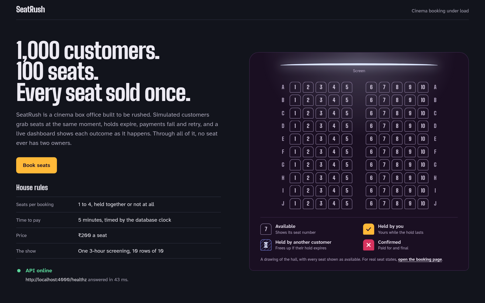

In a low-traffic application, database writes feel simple: an entity is read, modified in memory, and saved back. But under intense concurrency—such as a blockbuster cinema release, a concert on-sale, or flash ticketing—this naive model catastrophically collapses.

### The Physical Reality: The Thundering Herd at Seat A7

Imagine 1,000 HTTP requests arriving at the Express API within the exact same 50-millisecond window. By statistical preference, center seats like **A7**, **E5**, or **F5** are targeted by dozens or hundreds of customers simultaneously.

```
Request 001 (Customer 042) ──► SELECT seat WHERE label = 'A7' ──► Available
Request 002 (Customer 189) ──► SELECT seat WHERE label = 'A7' ──► Available
Request 003 (Customer 711) ──► SELECT seat WHERE label = 'A7' ──► Available
...
Request 050 (Customer 904) ──► SELECT seat WHERE label = 'A7' ──► Available
```

In the absence of rigorous database-level synchronization, all 50 execution threads observe that seat A7 has no active hold. Every single thread concludes: *"The seat is free; I will claim it."*

### Why Naive "Check-Then-Act" Fails (TOCTOU & Lost Updates)

In naive web applications, developers frequently write "check-then-act" code using ORMs:

```typescript
// ANTI-PATTERN: Naive application-level check-then-act
async function naiveClaimSeat(screeningId: string, customerId: string, seatId: string) {
  // Step 1: Check availability (Read)
  const seat = await prisma.seat.findUnique({
    where: { id: seatId }
  });

  if (seat.currentHoldId !== null) {
    throw new Error("Seat already taken");
  }

  // Step 2: Create hold record (Write)
  const hold = await prisma.hold.create({
    data: { screeningId, customerId, seatCount: 1, amountPaise: 50000 }
  });

  // Step 3: Assign seat to hold (Write)
  await prisma.seat.update({
    where: { id: seatId },
    data: { currentHoldId: hold.id }
  });

  return hold;
}
```

This code suffers from **Time-of-Check to Time-of-Use (TOCTOU)**:

1. **Interleaving:** Between the execution of `findUnique` (Time-of-Check) and `seat.update` (Time-of-Use), the operating system's thread scheduler or Node.js event loop yields execution. During this microsecond gap, 49 other requests execute their own `findUnique`.
2. **Stale Snapshot:** Every thread reads the exact same database state where `currentHoldId` is `NULL`.
3. **Lost Updates:** Each thread proceeds to `prisma.hold.create` and then executes `UPDATE seats SET current_hold_id = ...`. The last transaction to commit silently overwrites the previous ones.

### The Double-Allocation Failure Mode

The business outcome of naive check-then-act is catastrophic:
- 50 hold records exist in the `holds` table.
- 50 customers receive a successful HTTP `201 Created` response.
- 50 customers are prompted to enter payment credentials.
- The physical theater hall only has **one** seat A7.

When these customers pay, the theater has accepted payment for 50 tickets on 1 physical chair. This is a **double allocation** (or 50-fold allocation).

SeatRush prevents this entirely by enforcing that **PostgreSQL is the single, authoritative arbiter of truth**. Redis and queues are never allowed to decide or cache inventory ownership. When two or more requests collide on the same seat, exactly one succeeds and all others immediately receive a structured `409 Conflict`.

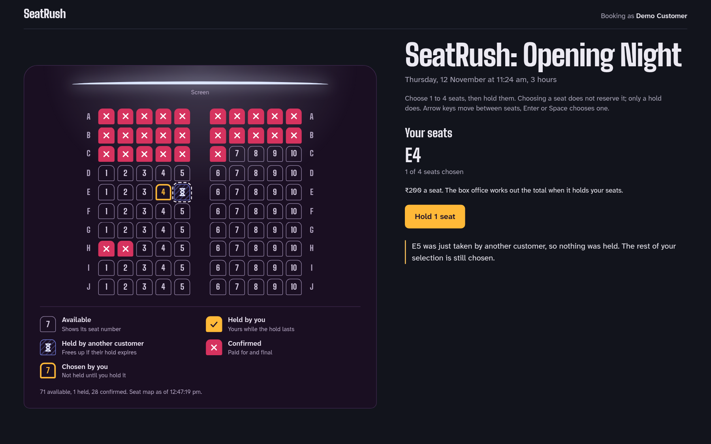

### Visualizing the Race: Naive TOCTOU vs. Pessimistic Serialization

To grasp how concurrency bugs manifest in real time, compare the naive application-level check against SeatRush's database-level serialization:

#### The Naive Check-Then-Act Failure (TOCTOU)

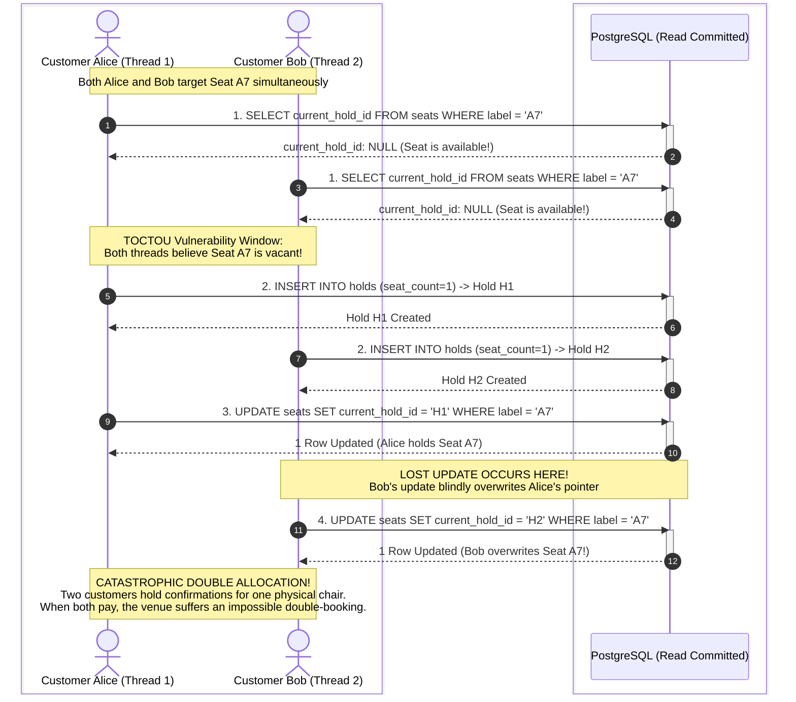

#### SeatRush Atomic Serialization via Pessimistic Row Lock (`claim_seats`)

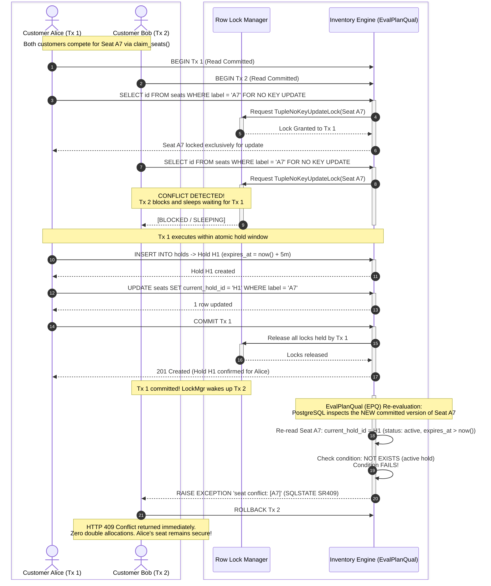

---

## 2. PostgreSQL MVCC & Isolation Levels

To understand why SeatRush is engineered the way it is, one must understand how PostgreSQL handles concurrency under the hood.

### Multi-Version Concurrency Control (MVCC) Mechanics

PostgreSQL does not lock tables or rows for simple read queries (`SELECT`). Instead, it uses **Multi-Version Concurrency Control (MVCC)**:
- Every table row (tuple) contains hidden system columns: `xmin` (the transaction ID that inserted the row) and `xmax` (the transaction ID that deleted or replaced the row).
- When a row is updated, PostgreSQL does not overwrite the disk bytes in place. It writes a **new version** of the tuple with its own `xmin` set to the current transaction ID, and marks the old tuple's `xmax` with that same transaction ID.
- Readers inspect tuples to determine which version is visible to their transaction snapshot.

**Core MVCC Rule:** *Readers never block writers, and writers never block readers.*

While this design yields extraordinary read throughput, it introduces a subtle trap for inventory systems: a standard `SELECT` sees only past committed state. It cannot tell whether another in-flight transaction is currently attempting to modify that exact row.

### Read Committed vs. Serializable: The Abort Storm Dilemma

ANSI SQL defines four isolation levels: *Read Uncommitted*, *Read Committed*, *Repeatable Read*, and *Serializable*.

When software engineers discover concurrency race conditions, a common instinct is: *"Set the transaction isolation level to `SERIALIZABLE` and let the database handle it."*

In SeatRush, this naive solution was deliberately **rejected**. Here is why:

#### How PostgreSQL Implements `SERIALIZABLE` (SSI)
PostgreSQL uses **Serializable Snapshot Isolation (SSI)**. SSI does not lock rows up front; instead, it tracks dependency graphs in shared memory using *SIREAD locks* on tuples and index pages. If it detects a dangerous read-write dependency cycle (rw-antidependencies), it aborts one of the transactions with:
```
ERROR: 40001: could not serialize access due to read/write dependencies among transactions
```

#### The Abort Storm Failure Mode
Under high contention (1,000 requests contesting 100 seats):
1. 50 transactions concurrently read the seat map and attempt to reserve seat A7.
2. Under `SERIALIZABLE`, PostgreSQL allows them all to run concurrently.
3. At commit time, 49 of the 50 transactions are aborted with SQLSTATE `40001`.
4. The application layer responds by retrying all 49 failed transactions.
5. These 49 retries now collide with 50 new incoming requests, creating an exponential **retry storm**.
6. CPU utilization reaches 100%, PostgreSQL connection pools saturate, and effective system throughput collapses to near zero.

#### The SeatRush Architecture: Read Committed + Pessimistic Locking
SeatRush uses short transactions at the default **Read Committed** isolation level, combined with **explicit, deterministic pessimistic row locks** (`FOR NO KEY UPDATE`).

In Read Committed mode:
- Each statement sees a fresh snapshot of all data committed up to the start of that statement.
- When an explicit row lock is requested, PostgreSQL pauses the transaction until the earlier lock-holder commits or rolls back.
- When the lock is granted, PostgreSQL executes **EvalPlanQual (EPQ)**: it re-evaluates the query condition against the *newly committed version* of the locked row.
- The first transaction claims the seat. The subsequent 49 transactions wake up, inspect the updated row, see that it is no longer available, and cleanly fail with a business-level `SR409` conflict—*without aborting the database transaction or triggering SSI retry storms*.

### Row-Level Lock Modes: `FOR UPDATE` vs. `FOR NO KEY UPDATE` vs. `FOR KEY SHARE`

PostgreSQL provides four row-level locking clauses. Understanding their exact differences is critical to systems programming:

| Lock Mode | Conflicting Lock Modes | Purpose / Typical Usage |
|---|---|---|
| `FOR UPDATE` | `FOR UPDATE`, `FOR NO KEY UPDATE`, `FOR SHARE`, `FOR KEY SHARE` | Exclusive write lock. Used when modifying columns involved in unique indexes or primary keys. |
| `FOR NO KEY UPDATE` | `FOR UPDATE`, `FOR NO KEY UPDATE`, `FOR SHARE` | Weaker exclusive lock. Locks the row for update, but **does not conflict** with `FOR KEY SHARE`. Used when modifying non-key columns (e.g. `current_hold_id`). |
| `FOR SHARE` | `FOR UPDATE`, `FOR NO KEY UPDATE` | Shared lock. Prevents concurrent modifications to the row. |
| `FOR KEY SHARE` | `FOR UPDATE` | Weak shared lock. Acquired automatically by PostgreSQL when checking foreign key constraints on parent tables. |

### Why `FOR NO KEY UPDATE` Was Essential for `claim_seats`

Look closely at the foreign keys defined in SeatRush's schema (`packages/db/prisma/migrations/20261107141030_initial_core/migration.sql`):

```sql
ALTER TABLE "hold_items" ADD CONSTRAINT "hold_items_seat_id_screening_id_fkey" 
  FOREIGN KEY ("seat_id", "screening_id") REFERENCES "seats"("id", "screening_id") 
  ON DELETE RESTRICT ON UPDATE RESTRICT;
```

Whenever a transaction inserts a row into `hold_items`, PostgreSQL must verify that the referenced `seats` row exists. To guarantee referential integrity without blocking the whole table, PostgreSQL automatically takes a **`FOR KEY SHARE`** lock on that referenced row in `seats`.

Now consider what happens if `claim_seats` used `FOR UPDATE`:
1. Transaction 1 executes `SELECT ... FROM seats ... FOR UPDATE`.
2. Transaction 2 attempts to insert a record into `hold_items` or `booked_seats` that references a seat.
3. PostgreSQL attempts to acquire `FOR KEY SHARE` on `seats` on behalf of Transaction 2's foreign key check.
4. **Collision:** `FOR UPDATE` conflicts with `FOR KEY SHARE`. Transaction 2 is blocked.
5. If Transaction 1 and Transaction 2 are acquiring locks on multiple resources, this creates immediate **deadlocks between business updates and foreign key validations**.

By using **`FOR NO KEY UPDATE`** on `seats`, `holds`, and `identities`:
- Claim writers serialize against each other (because `FOR NO KEY UPDATE` conflicts with `FOR NO KEY UPDATE`).
- But claim writers **do not block foreign key checks** (because `FOR NO KEY UPDATE` is fully compatible with `FOR KEY SHARE`).

This subtle distinction is documented in `packages/db/prisma/migrations/20261108030000_expiry_seat_refs_and_inventory_locks/migration.sql`:
```sql
-- Inventory writers change only ownership pointers, never seat keys. NO KEY UPDATE
-- keeps writers serialized without blocking hold-item/ticket foreign-key checks.
```

---

## 3. Deadlock Prevention via Strict Resource Ordering

### Anatomy of a Deadlock: Ordering Inversion

A deadlock occurs when two or more transactions hold locks that the other transactions need, creating a circular dependency cycle.

Consider two customers claiming adjacent seats simultaneously:
- **Customer Alice** wants seats **A1** and **A2**.
- **Customer Bob** wants seats **A2** and **A1**.

If the database or application locks seats in the order provided by the client request payload:

```
Timeline:
T1: Alice locks seat A1   (SUCCESS)
T2: Bob locks seat A2     (SUCCESS)
T3: Alice requests A2     (BLOCKED - waits for Bob)
T4: Bob requests A1       (BLOCKED - waits for Alice)
```

Neither transaction can proceed. Both are sleeping, waiting for the other. PostgreSQL's background `deadlock_detector` runs periodically (controlled by `deadlock_timeout`, default 1 second). Once it detects the cycle, it forcefully terminates one transaction with error:
```
ERROR: 40P01: deadlock detected
DETAIL: Process 12345 waits for ExclusiveLock on tuple ...; blocked by process 12346.
```

Deadlocks waste server capacity, abort user transactions, and indicate a severe design flaw in resource management.

### SeatRush's Total Lock Hierarchy (ADR 0001)

In systems engineering, the mathematical proof that deadlocks cannot occur is **Dijkstra's Resource Hierarchy Solution**: *If all concurrent processes acquire shared resources according to a strict, global total order, circular wait is impossible.*

SeatRush formalizes this in **ADR 0001** (`docs/adr/0001-seat-ownership-in-postgres.md`). Every transaction in the system—whether claiming seats, releasing holds, confirming bookings, expiring holds, or processing payments—must acquire row locks in this exact hierarchical sequence:

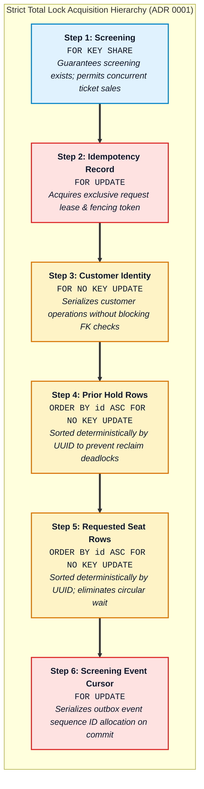

No database transaction is ever permitted to acquire an earlier lock after taking a later lock. The complete interaction protocol between the application tier and the PostgreSQL lock manager is visualized below:

```mermaid
sequenceDiagram
    autonumber
    box #f1f5f9 "API & Worker Tier"
        participant Client as API Request / Worker
    end
    box #ede9fe "PostgreSQL 18 Database Engine"
        participant Engine as Query Executor
        participant LockMgr as Row Lock Manager
        participant WAL as WAL & Storage Engine
    end

    Note over Client, Engine: Strict Resource Hierarchy Execution (ADR 0001)

    Client->>Engine: 1. SELECT id FROM screenings WHERE id = $1 FOR KEY SHARE
    activate Engine
    Engine->>LockMgr: Acquire TupleKeyShareLock (screenings)
    activate LockMgr
    Note over LockMgr: KEY SHARE: Shared lock compatible with other concurrent checkouts;<br/>blocks screening deletion or administrative reset.
    LockMgr-->>Engine: Lock Granted
    deactivate LockMgr
    Engine-->>Client: Screening verified & locked
    deactivate Engine

    Client->>Engine: 2. SELECT id FROM idempotency_records WHERE id = $2 FOR UPDATE
    activate Engine
    Engine->>LockMgr: Acquire TupleExclusiveLock (idempotency_records)
    activate LockMgr
    Note over LockMgr: FOR UPDATE: Exclusive write lock. Holds the 30-second<br/>fencing lease to prevent duplicate request execution.
    LockMgr-->>Engine: Lock Granted
    deactivate LockMgr
    Engine-->>Client: Idempotency lease secured
    deactivate Engine

    Client->>Engine: 3. SELECT id FROM identities WHERE id = $3 FOR NO KEY UPDATE
    activate Engine
    Engine->>LockMgr: Acquire TupleNoKeyUpdateLock (identities)
    activate LockMgr
    Note over LockMgr: NO KEY UPDATE: Serializes mutations on customer identity<br/>while allowing foreign key checks (KEY SHARE) from other tables.
    LockMgr-->>Engine: Lock Granted
    deactivate LockMgr
    Engine-->>Client: Customer identity locked
    deactivate Engine

    Client->>Engine: 4. SELECT id FROM holds WHERE id IN (...) ORDER BY id ASC FOR NO KEY UPDATE
    activate Engine
    Engine->>LockMgr: Acquire TupleNoKeyUpdateLock (holds, sorted by UUID)
    activate LockMgr
    Note over LockMgr: NO KEY UPDATE (Sorted ASC): Locks prior holders in deterministic<br/>UUID order to prevent reclaim deadlocks between simultaneous buyers.
    LockMgr-->>Engine: Locks Granted
    deactivate LockMgr
    Engine-->>Client: Prior holds locked
    deactivate Engine

    Client->>Engine: 5. SELECT id FROM seats WHERE id IN (...) ORDER BY id ASC FOR NO KEY UPDATE
    activate Engine
    Engine->>LockMgr: Acquire TupleNoKeyUpdateLock (seats, sorted by UUID)
    activate LockMgr
    Note over LockMgr: NO KEY UPDATE (Sorted ASC): Locks requested seats deterministically.<br/>Eliminates reverse-order deadlocks: [A1,A2] vs [A2,A1] serialize safely!
    LockMgr-->>Engine: Locks Granted
    deactivate LockMgr
    Engine-->>Client: Inventory seats locked
    deactivate Engine

    Client->>Engine: 6. SELECT screening_id FROM screening_event_cursors WHERE screening_id = $1 FOR UPDATE
    activate Engine
    Engine->>LockMgr: Acquire TupleExclusiveLock (screening_event_cursors)
    activate LockMgr
    Note over LockMgr: FOR UPDATE: Final serialization step. Allocates strictly monotonic<br/>sequence IDs for transactional outbox events upon commit.
    LockMgr-->>Engine: Lock Granted
    deactivate LockMgr
    Engine-->>Client: Sequence cursor locked
    deactivate Engine

    Client->>Engine: COMMIT TRANSACTION
    activate Engine
    Engine->>WAL: Write transaction commit record to WAL
    activate WAL
    WAL-->>Engine: Disk flush confirmed
    deactivate WAL
    Engine->>LockMgr: Release all row and relation locks simultaneously
    activate LockMgr
    LockMgr-->>Engine: All locks freed
    deactivate LockMgr
    Engine-->>Client: 200 OK / 201 Created
    deactivate Engine
```

No database transaction is ever permitted to acquire an earlier lock after taking a later lock.

### Deterministic ID Sorting in `claim_seats`

Look at how this total ordering is enforced in production code (`packages/db/prisma/migrations/20261108030000_expiry_seat_refs_and_inventory_locks/migration.sql`):

```sql
-- Lock Step 1: Parent Screening
SELECT seat_price_paise INTO price FROM screenings WHERE id = p_screening_id FOR KEY SHARE;

-- Lock Step 2: Customer Identity
PERFORM id FROM identities WHERE id = p_customer_id AND role = 'customer' FOR NO KEY UPDATE;

-- Lock Step 3: Prior holds currently attached to requested seats (SORTED BY ID)
PERFORM old.id FROM holds old WHERE old.id IN (
  SELECT current_hold_id FROM seats WHERE screening_id = p_screening_id AND id = ANY(p_seat_ids)
) ORDER BY old.id FOR NO KEY UPDATE;

-- Lock Step 4: Seat inventory rows (SORTED BY ID)
PERFORM id FROM seats WHERE screening_id = p_screening_id AND id = ANY(p_seat_ids) ORDER BY id FOR NO KEY UPDATE;
```

Notice the crucial clause:
```sql
ORDER BY id FOR NO KEY UPDATE
```

Even if Alice sends `["A1", "A2"]` and Bob sends `["A2", "A1"]`, PostgreSQL does not lock the rows in the order of the array. The `ORDER BY id` clause forces PostgreSQL to sort the rows by their primary key UUIDs in ascending binary order before acquiring locks:

1. Both Alice and Bob attempt to lock the seat with the lower UUID first (e.g. `A1`).
2. Whichever transaction gets `A1` first proceeds.
3. The other transaction blocks at `A1` *before it has acquired any lock on `A2`*.
4. Circular wait is eliminated. Deadlocks are mathematically impossible.

This guarantee is tested rigorously in `packages/db/tests/ownership.test.ts` (line 241):
```typescript
it("cleans up versus reverse-order reclaim 1000 times without deadlocks or owner clobbering", async () => { ... });
```
Even under 1,000 rapid cycles of reverse-order claims, zero deadlocks (`40P01`) occur.

---

## 4. All-or-Nothing Atomicity in SQL

### The Multi-Seat Partial Allocation Trap

In cinema ticketing, customers reserve between 1 and 4 adjacent seats for their party.

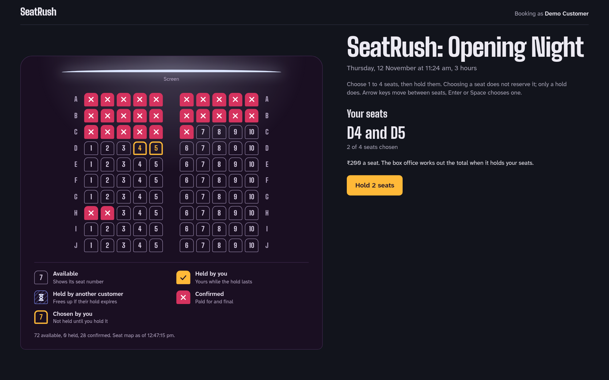

Suppose a family selects seats **C3, C4, C5**. Another customer selects **C5, C6**.
If the reservation engine handles seat updates independently:
- C3 is reserved for the family.
- C4 is reserved for the family.
- C5 is reserved for the second customer.

Now the family has 2 seats instead of 3, splitting their party, and the transaction is in an inconsistent partial state. **FR-02** dictates that seat holds must be strictly **all-or-nothing**: if even a single requested seat is unavailable, the entire reservation must fail, leaving all requested seats untouched.

### Step-by-Step Breakdown of `claim_seats(...)`

SeatRush encapsulates this entire atomic operation into a single PostgreSQL PL/pgSQL function: `claim_seats(p_screening_id uuid, p_customer_id uuid, p_seat_ids uuid[])`.

Let us trace its execution step by step:

#### Step 1: Input Validation
```sql
n := cardinality(p_seat_ids);
IF n IS NULL OR n NOT BETWEEN 1 AND 4 OR n <> (SELECT count(DISTINCT id) FROM unnest(p_seat_ids) AS id) THEN
  RAISE EXCEPTION 'request must contain 1-4 distinct seats' USING ERRCODE = '22023';
END IF;
```
Enforces that the request contains between 1 and 4 seats and contains no duplicate seat IDs.

#### Step 2: Lock Screening & Customer
```sql
SELECT seat_price_paise INTO price FROM screenings WHERE id = p_screening_id FOR KEY SHARE;
IF NOT FOUND THEN RAISE EXCEPTION 'screening not found' USING ERRCODE = 'SR404'; END IF;

PERFORM id FROM identities WHERE id = p_customer_id AND role = 'customer' FOR NO KEY UPDATE;
IF NOT FOUND THEN RAISE EXCEPTION 'customer not found' USING ERRCODE = 'SR401'; END IF;
```
Ensures the screening and customer exist and locks their rows to prevent concurrent deletion or modification.

#### Step 3: Enforce One Active Hold Rule
```sql
IF EXISTS (SELECT 1 FROM holds WHERE customer_id = p_customer_id AND screening_id = p_screening_id AND status = 'active' AND expires_at > now()) THEN
  RAISE EXCEPTION 'customer already has an active hold' USING ERRCODE = 'SR410';
END IF;
```
Fast-fails if the customer already has an active hold on this screening.

#### Step 4: Lock Resources in Strict Order
```sql
PERFORM old.id FROM holds old WHERE old.id IN (
  SELECT current_hold_id FROM seats WHERE screening_id = p_screening_id AND id = ANY(p_seat_ids)
) ORDER BY old.id FOR NO KEY UPDATE;

PERFORM id FROM seats WHERE screening_id = p_screening_id AND id = ANY(p_seat_ids) ORDER BY id FOR NO KEY UPDATE;
GET DIAGNOSTICS claimed = ROW_COUNT;
IF claimed <> n THEN RAISE EXCEPTION 'unknown or foreign screening seat' USING ERRCODE = '22023'; END IF;
```
Locks existing holds and all requested seats in ascending ID order. Verifies that the row count locked equals $n$. If a seat belongs to another screening, it fails with `22023`.

#### Step 5: Detect Conflicts
```sql
SELECT jsonb_agg(s.id ORDER BY s.id) INTO conflicts FROM seats s LEFT JOIN holds old ON old.id = s.current_hold_id
  WHERE s.screening_id = p_screening_id AND s.id = ANY(p_seat_ids)
    AND (EXISTS (SELECT 1 FROM booked_seats bs WHERE bs.screening_id = s.screening_id AND bs.seat_id = s.id)
      OR (old.status = 'active' AND old.expires_at > now()));
IF conflicts IS NOT NULL THEN
  RAISE EXCEPTION 'seat conflict: %', conflicts USING ERRCODE = 'SR409', DETAIL = conflicts::text;
END IF;
```
Checks if any requested seat is already booked (`booked_seats`) or held by an active, unexpired hold. If so, raises `SR409` with a JSON payload of conflicting seat IDs.

### Conditional CTE Updates and `SR409` Conflict Signaling

Even after checking for conflicts, SeatRush performs a **defensive conditional update** using a Common Table Expression (CTE):

```sql
INSERT INTO holds (screening_id, customer_id, seat_count, amount_paise)
  VALUES (p_screening_id, p_customer_id, n, price * n) RETURNING * INTO h;

INSERT INTO hold_items (hold_id, seat_id, screening_id, price_paise)
  SELECT h.id, id, p_screening_id, price FROM seats WHERE screening_id = p_screening_id AND id = ANY(p_seat_ids);

WITH claimed_seats AS (
  UPDATE seats s SET current_hold_id = h.id
    WHERE s.screening_id = p_screening_id AND s.id = ANY(p_seat_ids)
      AND NOT EXISTS (SELECT 1 FROM booked_seats bs WHERE bs.screening_id = s.screening_id AND bs.seat_id = s.id)
      AND NOT EXISTS (SELECT 1 FROM holds old WHERE old.id = s.current_hold_id AND old.status = 'active' AND old.expires_at > now())
    RETURNING s.id
) SELECT count(*) INTO claimed FROM claimed_seats;

IF claimed <> n THEN 
  RAISE EXCEPTION 'seat conflict' USING ERRCODE = 'SR409'; 
END IF;

RETURN NEXT h;
```

Notice the safeguard:
1. The `UPDATE seats` statement carries its own `WHERE NOT EXISTS` clauses verifying that the seat is neither booked nor actively held.
2. The `RETURNING s.id` clause counts how many seat rows were *actually updated*.
3. If `claimed <> n` (for instance, if 3 seats were requested but only 2 were free), the function executes `RAISE EXCEPTION ... USING ERRCODE = 'SR409'`.
4. In PostgreSQL, raising an unhandled exception inside a function **immediately aborts the entire transaction**.
5. The `INSERT INTO holds` and `INSERT INTO hold_items` are completely rolled back. Zero partial records remain.

---

## 5. Database Invariants & Defensive Constraints

In a distributed system, application-tier validation is insufficient. Code has bugs, libraries get updated, and background jobs or administrative scripts might execute raw SQL directly against the database.

SeatRush implements **Defense-in-Depth**: the database schema itself renders invalid states structurally impossible.


### Relational Schema & Entity Relationships

The foundation of SeatRush's concurrency safety is its strict relational data model. Every entity, foreign key, and cardinality constraint is designed to prevent orphan states, double allocations, and unrecorded financial liabilities at the database kernel level:

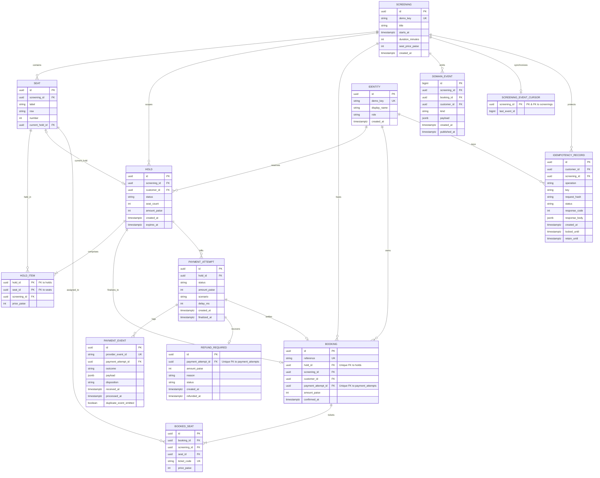

#### Concurrency Architectural Highlights in the Schema:
1. **Referential Lock Independence:** Foreign key references from `hold_items` and `booked_seats` to `seats` take `KEY SHARE` locks on referenced rows during insertion. Claim transactions lock seats with `FOR NO KEY UPDATE` rather than `FOR UPDATE`, ensuring business mutations never deadlock against foreign key verifications.
2. **Fast Ownership Pointers:** `seats.current_hold_id` provides $O(1)$ fast-path availability lookups, while deferred integrity trigger `assert_hold_integrity` guarantees 100% bidirectional consistency between `seats`, `holds`, and `hold_items` at transaction commit.
3. **Fenced Financial Reconciliation:** `payment_attempts` transitions into an absorbing state, fanning out either to a completed `bookings` record or to an immutable `refund_required` record if the hold expires before webhook delivery (FR-05).
### The Immutable Hold Clock: `CHECK` + `BEFORE INSERT/UPDATE` Triggers

Holds in SeatRush are strictly valid for **exactly 5 minutes**.

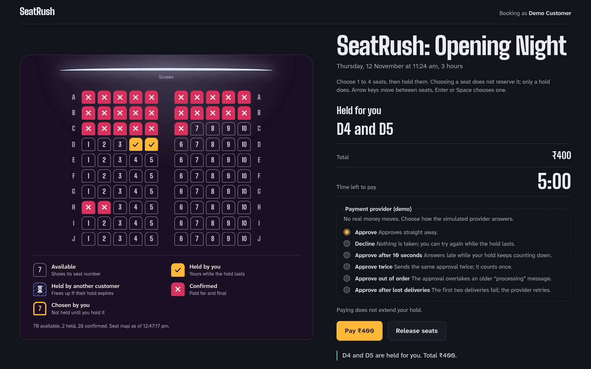

A naive implementation might allow the client or API server to supply `expiresAt`:
```typescript
// INSECURE: Allowing client or application clock to set expiry
const expiresAt = new Date(Date.now() + 5 * 60 * 1000);
```
This fails when server clocks drift, when malicious clients tamper with payloads, or when network latency delays the request.

SeatRush enforces the 5-minute hold window strictly at the database engine level:

#### 1. Schema CHECK Constraint
```sql
ALTER TABLE holds ADD CONSTRAINT holds_values_check
  CHECK (status IN ('active', 'released', 'expired', 'confirmed')
    AND seat_count BETWEEN 1 AND 4 AND amount_paise > 0
    AND expires_at = created_at + interval '5 minutes');
```
PostgreSQL validates that `expires_at` is mathematically equal to `created_at + interval '5 minutes'`.

#### 2. Authoritative Database Clock Trigger
```sql
CREATE FUNCTION guard_hold_clock() RETURNS trigger LANGUAGE plpgsql AS $$
BEGIN
  IF TG_OP = 'INSERT' THEN
    NEW.created_at := now();
    NEW.expires_at := now() + interval '5 minutes';
  ELSIF NEW.created_at > OLD.created_at OR NEW.expires_at > OLD.expires_at
    OR (NEW.id, NEW.screening_id, NEW.customer_id, NEW.seat_count, NEW.amount_paise)
      IS DISTINCT FROM (OLD.id, OLD.screening_id, OLD.customer_id, OLD.seat_count, OLD.amount_paise) THEN
    RAISE EXCEPTION 'hold identity, price and deadline cannot be extended or changed' USING ERRCODE = '23514';
  END IF;
  RETURN NEW;
END $$;

CREATE TRIGGER holds_clock BEFORE INSERT OR UPDATE ON holds 
  FOR EACH ROW EXECUTE FUNCTION guard_hold_clock();
```
- On `INSERT`: Any client-supplied timestamps are overwritten with `now()` (the PostgreSQL transaction-start clock) and `now() + 5 minutes`.
- On `UPDATE`: Any attempt to extend `expires_at`, change `created_at`, or alter the customer, seat count, or amount raises error `23514` (check violation). A hold deadline is immutable.

### Temporal Exclusion Constraints: `EXCLUDE USING gist`

The business rule states: *A customer may hold at most one set of seats per screening at any given time.*

A naive database design uses a unique index:
```sql
-- BROKEN: Unique index on customer and screening
CREATE UNIQUE INDEX holds_customer_screening ON holds (customer_id, screening_id) WHERE status = 'active';
```
Why does this fail?
If Customer Alice holds seats A1–A2 at 12:00, and lets them expire at 12:05 without manual release, the row remains in the table with `status = 'active'` until a background cleanup worker runs.
If Alice tries to hold seats B1–B2 at 12:06, the unique index rejects her request because an `active` row still exists—even though it is expired!

SeatRush solves this with a **Temporal Exclusion Constraint** using the `btree_gist` extension:

```sql
CREATE EXTENSION IF NOT EXISTS btree_gist;

ALTER TABLE holds ADD CONSTRAINT holds_one_active_customer
  EXCLUDE USING gist (
    customer_id WITH =, 
    screening_id WITH =,
    tstzrange(created_at, expires_at, '[)') WITH &&
  ) WHERE (status = 'active');
```

#### How it works:
1. `tstzrange(created_at, expires_at, '[)')` represents the hold's lifetime as a continuous temporal range (closed start, open end).
2. The `&&` operator checks for **range overlap**.
3. Two holds for the same customer and screening are prohibited **only if their active time windows overlap**.
4. Once `now() >= expires_at`, a new hold created with range `[now(), now() + 5m)` has **zero overlap** with the previous hold `[t0, t0 + 5m)`.
5. Therefore, Alice can immediately claim new seats after her old hold expires, without waiting for any background cleanup job!

### Deferred Integrity Constraints: `assert_hold_integrity`

Relational integrity often requires multi-row consistency that cannot be checked during individual row inserts.

For example, when a hold is created, the system must guarantee that:
1. The `seat_count` and `amount_paise` on `holds` exactly match the count and summed price of rows in `hold_items`.
2. Every seat referenced by an active hold points its `current_hold_id` back to that hold.
3. No seat referenced by an active hold is also present in `booked_seats`.

SeatRush enforces this using **Deferred Constraint Triggers**:

```sql
CREATE FUNCTION assert_hold_integrity(p_hold_id uuid) RETURNS void LANGUAGE plpgsql AS $$
DECLARE h holds%ROWTYPE; item_count bigint; total bigint;
BEGIN
  SELECT * INTO h FROM holds WHERE id = p_hold_id;
  IF NOT FOUND THEN RETURN; END IF;

  SELECT count(*), coalesce(sum(price_paise), 0) INTO item_count, total 
  FROM hold_items WHERE hold_id = h.id;

  IF item_count <> h.seat_count OR total <> h.amount_paise THEN
    RAISE EXCEPTION 'hold items or amount mismatch' USING ERRCODE = '23514';
  END IF;

  IF h.status = 'active' AND h.expires_at > now() AND EXISTS (
    SELECT 1 FROM hold_items hi JOIN seats s ON s.id = hi.seat_id
    WHERE hi.hold_id = h.id AND (s.current_hold_id IS DISTINCT FROM h.id
      OR EXISTS (SELECT 1 FROM booked_seats bs WHERE bs.seat_id = s.id AND bs.screening_id = s.screening_id))
  ) THEN
    RAISE EXCEPTION 'active hold does not exclusively own all its seats' USING ERRCODE = '23514';
  END IF;

  IF h.status = 'confirmed' AND NOT EXISTS (SELECT 1 FROM bookings WHERE hold_id = h.id) THEN
    RAISE EXCEPTION 'confirmed hold requires a booking' USING ERRCODE = '23514';
  END IF;
END $$;

CREATE CONSTRAINT TRIGGER holds_integrity AFTER INSERT OR UPDATE ON holds
  DEFERRABLE INITIALLY DEFERRED FOR EACH ROW EXECUTE FUNCTION check_hold_row();

CREATE CONSTRAINT TRIGGER hold_items_integrity AFTER INSERT OR UPDATE OR DELETE ON hold_items
  DEFERRABLE INITIALLY DEFERRED FOR EACH ROW EXECUTE FUNCTION check_hold_item_row();

CREATE CONSTRAINT TRIGGER seats_hold_integrity AFTER INSERT OR UPDATE ON seats
  DEFERRABLE INITIALLY DEFERRED FOR EACH ROW EXECUTE FUNCTION check_seat_hold_row();
```

#### Why `DEFERRABLE INITIALLY DEFERRED` Matters
If these triggers were immediate, an `INSERT INTO holds` would fail instantly because `hold_items` rows haven't been inserted yet!
By marking them `DEFERRABLE INITIALLY DEFERRED`, PostgreSQL delays execution of the trigger functions until the **very end of the transaction (`COMMIT`)**.
At commit time, the entire graph of `holds`, `hold_items`, and `seats` must be 100% consistent. If any invariant is violated, the transaction is rejected.

---

## 6. State Machines & Absorbing States

Distributed systems become uncontrollable when state transitions are bidirectional or loosely defined. SeatRush models all domain lifecycles as strict finite state machines with **absorbing (terminal) states**.

### The Hold Lifecycle & Self-Expiring Reads

```mermaid
stateDiagram-v2
    [*] --> Active : claim_seats() [Atomic Pessimistic Lock]

    state Active {
        [*] --> UnexpiredClock : now() < expires_at
        UnexpiredClock --> ApproachingExpiry : 5-minute countdown
        ApproachingExpiry : Visual Countdown Ring
        ApproachingExpiry : Non-extendable database clock
    }

    Active --> Released : release_hold() [Customer Manual Intent]
    Active --> Expired : expires_at <= now() [Self-Expiring Read / Worker Sweep]
    Active --> Confirmed : prepare_booking() [Full Payment Captured]

    Released --> [*] : Seats Returned to Available Pool
    Expired --> [*] : Seats Instantly Reclaimable by Next Customer
    Confirmed --> [*] : BookedSeats Created & Tickets Issued

    note right of Active
        <b>Defensive Constraints:</b><br/>• CHECK (expires_at = created_at + 5min)<br/>• Trigger guard_hold_clock()<br/>• Exclusion: holds_one_active_customer<br/>• Deferred: assert_hold_integrity()
    end note

    note right of Confirmed
        <b>Absorbing Business State:</b><br/>• Immutable outside demo reset<br/>• Clears seat current_hold_id<br/>• Emits booking.confirmed
    end note

    note right of Expired
        <b>Zero-Dependency Availability:</b><br/>• Read queries evaluate expires_at <= now()<br/>• Reclaim is instant without worker delays
    end note
```

A hold begins in the `active` state. From `active`, it can transition to exactly one of three terminal states:
- `released`: The user explicitly clicked "Release Hold".
- `expired`: The 5-minute countdown elapsed.
- `confirmed`: Payment succeeded and tickets were issued.

#### Why Expired Holds Are Non-Blocking Without Cleanup
A critical architectural property of SeatRush is that **availability does not depend on queue workers**.
When any transaction queries whether a seat is free, it executes:
```sql
WHERE NOT EXISTS (
  SELECT 1 FROM holds old 
  WHERE old.id = s.current_hold_id 
    AND old.status = 'active' 
    AND old.expires_at > now()
)
```
If a hold's `expires_at <= now()`, it is treated as instantly available.
Even if the BullMQ worker is delayed, restarted, or offline, another customer can reclaim that seat immediately.

When the worker's background sweep eventually runs (`cleanup_expired_hold`), it cleans up seats via:
```sql
WITH cleared AS (
  UPDATE seats s SET current_hold_id = NULL 
  WHERE s.current_hold_id = p_hold_id
  RETURNING s.id, s.label, s.row, s.number
)
SELECT cleared.id, cleared.label FROM cleared;
```
If a newer customer already reclaimed seat A1, `s.current_hold_id` is now the new hold's ID. The `UPDATE seats ... WHERE s.current_hold_id = p_hold_id` matches zero rows for A1.
**The cleanup sweep never clobbers a newer owner.**

### The PaymentAttempt Lifecycle & Absorbing Terminal States

Payment attempts simulate real-world card and webhook integrations across 6 realistic provider scenarios.


```mermaid
stateDiagram-v2
    [*] --> Initiated : POST /payments [Idempotent Request]

    state "PaymentAttempt: initiated" as Initiated
    state "PaymentAttempt: succeeded" as Succeeded
    state "PaymentAttempt: failed" as Failed

    Initiated --> Succeeded : Webhook / Notification (outcome = 'succeeded')
    Initiated --> Failed : Webhook / Notification (outcome = 'failed')

    Failed --> [*] : Terminal (Hold persists until 5m expiry or release)

    state "Fork on Hold Liveness (FR-05)" as Fork <<choice>>
    Succeeded --> Fork : Evaluate Hold State in Tx

    state "Booking Confirmed" as ConfirmedBooking
    state "Refund Required" as RefundReq
    state "Refund Processing" as RefundProc
    state "Refund Succeeded" as RefundDone

    Fork --> ConfirmedBooking : Hold active AND owns seats
    Fork --> RefundReq : Hold expired OR seats reclaimed

    ConfirmedBooking --> [*] : Tickets Issued (No liability)

    state "Two-Phase Refund Recovery Loop" as RefundRecovery {
        RefundReq --> RefundProc : completeRefund() Phase 1 [Worker Lease]
        RefundProc --> RefundDone : completeRefund() Phase 2 [Gateway Settlement]
        RefundDone --> [*]
    }

    note right of Succeeded
        <b>Absorbing Terminal State:</b><br/>• Trigger guard_payment_transition()<br/>• Record is permanently immutable
    end note

    note right of RefundReq
        <b>FR-05 Automatic Protection:</b><br/>• Durable row in refund_required<br/>• Outbox event refund.required emitted<br/>• Bob's reclaimed seat untouched
    end note

    note right of RefundProc
        <b>Crash-Resilient Settlement:</b><br/>• Status 'processing' committed first<br/>• Worker reboot recovers in-flight work
    end note
```

Payment attempts start as `initiated`. They can transition to `succeeded` or `failed`.

#### Enforcing Absorbing States in PostgreSQL
To prevent replay attacks, out-of-order webhook delivery, or race conditions from modifying a finalized payment, SeatRush attaches an immutable guard trigger (`packages/db/prisma/migrations/20261107141030_initial_core/migration.sql`):

```sql
CREATE FUNCTION guard_payment_transition() RETURNS trigger LANGUAGE plpgsql AS $$
BEGIN
  IF OLD.status <> 'initiated' AND NEW IS DISTINCT FROM OLD THEN
    RAISE EXCEPTION 'final payment attempt is immutable' USING ERRCODE = '23514';
  END IF;
  IF NEW.hold_id <> OLD.hold_id OR NEW.amount_paise <> OLD.amount_paise THEN
    RAISE EXCEPTION 'payment identity and amount are immutable' USING ERRCODE = '23514';
  END IF;
  RETURN NEW;
END $$;

CREATE TRIGGER payment_attempts_absorbing BEFORE UPDATE ON payment_attempts
  FOR EACH ROW EXECUTE FUNCTION guard_payment_transition();
```
Once a payment attempt reaches `succeeded` or `failed`, **no SQL statement in the database can ever change its status, amount, or hold reference**.

### The Race Condition: Payment Success vs. Hold Expiry (FR-05)

Here lies the most dangerous race condition in financial inventory systems:

#### The Scenario
1. At **12:00:00**, Customer Alice holds seat A7. Expiry is set to **12:05:00**.
2. At **12:04:55**, Alice submits payment for ₹500.00.
3. The payment gateway suffers a 10-second processing delay.
4. At **12:05:00**, Alice's hold officially expires.
5. At **12:05:01**, Customer Bob claims seat A7. Bob's hold is created and Bob begins checkout.
6. At **12:05:05**, the payment gateway finally returns `succeeded` for Alice's payment!

#### What Should the System Do?
- **Bad Choice 1:** Confirm Alice's booking and evict Bob. (Violates Bob's active hold; breaks system invariants).
- **Bad Choice 2:** Keep Alice's money and confirm Bob. (Theft / unrecorded liability).
- **Bad Choice 3:** Crash or throw an unhandled error. (Leaves system in indeterminate state).

#### The SeatRush Solution (FR-05)
Under the ownership lock order, the webhook transaction in `applyNotification` (`apps/api/src/payments.ts`) executes:

```typescript
// 1. Lock resources in strict order
await tx.$queryRaw`SELECT id FROM screenings WHERE id=${target.screeningId}::uuid FOR KEY SHARE`;
await tx.$queryRaw`SELECT id FROM identities WHERE id=${target.customerId}::uuid FOR NO KEY UPDATE`;
await tx.$queryRaw`SELECT id FROM holds WHERE id=${target.holdId}::uuid FOR NO KEY UPDATE`;
await tx.$queryRaw`SELECT s.id FROM seats s JOIN hold_items hi ON hi.seat_id=s.id 
  WHERE hi.hold_id=${target.holdId}::uuid ORDER BY s.id FOR NO KEY UPDATE OF s`;

// 2. Inspect if hold is still active and exclusively owns all seats
const [hold] = await tx.$queryRaw<{status: string; live: boolean}[]>`
  SELECT status,
    expires_at > now() AND NOT EXISTS (
      SELECT 1 FROM hold_items hi JOIN seats s ON s.id = hi.seat_id
      WHERE hi.hold_id = h.id AND s.current_hold_id IS DISTINCT FROM h.id
    ) AS live
  FROM holds h WHERE id = ${target.holdId}::uuid`;

// 3. Update payment attempt to 'succeeded'
await tx.$executeRaw`UPDATE payment_attempts SET status = 'succeeded', finalized_at = now() 
  WHERE id = ${n.paymentAttemptId}::uuid`;

// 4. THE FORK: If hold is alive -> Confirm Booking. If expired -> Trigger Refund!
if (hold.status === 'active' && hold.live) {
  await tx.$executeRaw`INSERT INTO bookings (hold_id, screening_id, customer_id, payment_attempt_id, amount_paise)
    VALUES (${target.holdId}::uuid, ${target.screeningId}::uuid, ${target.customerId}::uuid, ${n.paymentAttemptId}::uuid, ${attempt.amount})`;
  return { disposition: 'applied' };
}

// LATE SUCCESS: Hold expired or released!
const reason = hold.status === 'released' ? 'hold_released' : 'hold_expired';
const [refund] = await tx.$queryRaw<{id: string}[]>`
  INSERT INTO refund_required (payment_attempt_id, amount_paise, reason) 
  VALUES (${n.paymentAttemptId}::uuid, ${attempt.amount}, ${reason}) RETURNING id`;

await emitPaymentEvent(tx, target.holdId, 'refund.required', {
  paymentAttemptId: n.paymentAttemptId,
  amountPaise: attempt.amount,
  reason
});

return { disposition: 'applied', refundRequiredId: refund.id };
```

**The Outcome:**
- Bob's hold on seat A7 remains 100% intact and unviolated.
- Alice's payment is marked `succeeded`.
- A durable row in `refund_required` is created in the exact same transaction.
- An outbox event `refund.required` is committed.
- Both customer invariants are completely preserved.

#### Visualizing the Race Condition Timeline (FR-05)

The sequence diagram below reveals how the database kernel serializes Alice's late payment and Bob's legitimate seat reclaim without data corruption:

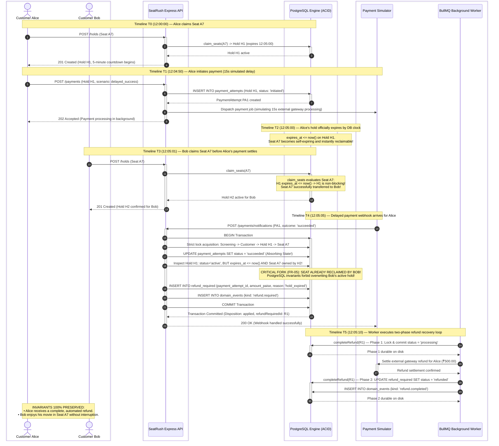

### The Two-Phase Refund Recovery Loop

Once a refund is required, it must be executed reliably even across server crashes (`packages/db/src/payments.ts`):

```typescript
export async function completeRefund(prisma: PrismaClient, refundRequiredId: string): Promise<'completed'|'noop'> {
  // Commit processing before simulating settlement, so a crashed worker leaves recoverable work.
  for (const phase of ['processing', 'refunded'] as const) {
    const result = await prisma.$transaction(async tx => {
      // Step 1: Acquire locks in order
      await tx.$queryRaw`SELECT id FROM screenings WHERE id=${target.screeningId}::uuid FOR KEY SHARE`;
      await tx.$queryRaw`SELECT id FROM holds WHERE id=${target.holdId}::uuid FOR NO KEY UPDATE`;
      const [refund] = await tx.$queryRaw`... FROM refund_required WHERE id=${refundRequiredId}::uuid FOR UPDATE`;

      if (phase === 'processing') {
        if (refund.status === 'required') {
          await tx.$executeRaw`UPDATE refund_required SET status='processing' WHERE id=${refundRequiredId}::uuid`;
        }
        return 'processing';
      }

      // Step 2: Settle refund and emit event
      await tx.$executeRaw`UPDATE refund_required SET status='refunded', refunded_at=now() WHERE id=${refundRequiredId}::uuid`;
      await emitPaymentEvent(tx, target.holdId, 'refund.completed', {
        paymentAttemptId: refund.paymentAttemptId,
        amountPaise: refund.amountPaise
      }, false);
      return 'completed';
    });
    if (result !== 'processing') return result;
  }
}
```
By committing `status = 'processing'` to PostgreSQL *before* contacting the external payment gateway, a worker crash during external HTTP calls leaves a durable trail. On reboot, the sweep detects stale `processing` refunds and recovers them cleanly.

---

## 7. The Transactional Outbox Pattern & Event Ordering

### The Dual-Write Hazard: Ghost Bookings & Lost Events

In microservice or event-driven architectures, developers often write code like this:

```typescript
// ANTI-PATTERN: Distributed Dual-Write
async function confirmBooking(bookingData) {
  // Write 1: Update relational database
  const booking = await db.booking.create({ data: bookingData });

  // Write 2: Publish event to Redis / Kafka / RabbitMQ
  await redis.publish("booking-events", JSON.stringify(booking));

  return booking;
}
```

This pattern suffers from the **Dual-Write Hazard**:

1. **Failure Mode A (Node Crash):** The database transaction commits successfully. Before `redis.publish` completes, the Node.js process crashes (OOM, power failure, container kill). The booking exists in the database, but **no event was ever published**. Downstream notification workers, ticket generators, and analytics services never find out.
2. **Failure Mode B (Rollback):** A developer swaps the order, publishing to Redis first. The Redis publish succeeds, but the database transaction subsequently rolls back due to a constraint violation. Downstream systems process a **ghost booking** that does not exist in the database!

No amount of `try/catch` blocks or retries can solve the dual-write problem across two separate distributed systems without distributed transactions (2PC), which are notoriously brittle and slow.

### Transactional Outbox Architecture

SeatRush solves this using the **Transactional Outbox Pattern**:

```
┌────────────────────────────────────────────────────────┐
│               PostgreSQL ACID Transaction              │
│                                                        │
│  1. INSERT INTO bookings (...)                         │
│  2. INSERT INTO booked_seats (...)                     │
│  3. UPDATE holds SET status = 'confirmed'              │
│  4. UPDATE seats SET current_hold_id = NULL            │
│  5. INSERT INTO domain_events (...)                    │
│                                                        │
└────────────────────────────────────────────────────────┘
                           │
                 [Commit Together or Rollback Together]
                           ▼
                  PostgreSQL WAL & Tables
```

Business mutations and domain events are written to the **same database engine within the exact same atomic transaction**.
- If the transaction commits, both the booking and the event are guaranteed to be durable on disk.
- If the transaction fails, both are rolled back. Ghost events and lost events are mathematically impossible.

### The Sequence Cursor Pattern: `screening_event_cursors`

Once events are written to an outbox table, how do consumers read them in strict, unbroken chronological order?

#### The Flaw of `BIGSERIAL` Under Concurrency
A standard auto-incrementing ID (`id BIGSERIAL`) does **not** guarantee commit ordering:
1. Transaction A starts and acquires `id = 101` from the sequence.
2. Transaction B starts and acquires `id = 102` from the sequence.
3. Transaction B performs a tiny write and commits immediately at $T_1$.
4. A polling worker queries `WHERE id > 100`. It sees `id = 102`. It processes event 102 and records `last_seen_id = 102`.
5. Transaction A finally commits at $T_2$.
6. Event 101 is now written to disk. But the worker will **never see event 101**, because its cursor is already at 102!

#### The SeatRush Solution
SeatRush enforces strict commit ordering per screening using a dedicated cursor table and trigger (`packages/db/prisma/migrations/20261107220000_ordered_events_and_web_auth/migration.sql`):

```sql
CREATE TABLE screening_event_cursors (
  screening_id uuid PRIMARY KEY REFERENCES screenings(id) ON DELETE CASCADE ON UPDATE RESTRICT,
  last_event_id bigint NOT NULL DEFAULT 0 CHECK (last_event_id >= 0)
);

CREATE FUNCTION serialize_screening_event() RETURNS trigger LANGUAGE plpgsql AS $$
BEGIN
  -- 1. Take exclusive row lock on this screening's event cursor
  PERFORM screening_id FROM screening_event_cursors 
  WHERE screening_id = NEW.screening_id FOR UPDATE;
  
  IF NOT FOUND THEN 
    RAISE EXCEPTION 'screening event cursor missing' USING ERRCODE = '23503'; 
  END IF;

  -- 2. Allocate the sequence ID only AFTER the cursor lock is held
  NEW.id := nextval(pg_get_serial_sequence('domain_events', 'id'));
  NEW.created_at := date_trunc('milliseconds', clock_timestamp());
  NEW.payload := NEW.payload || jsonb_build_object(
    'id', NEW.id::text,
    'at', to_char(NEW.created_at AT TIME ZONE 'UTC', 'YYYY-MM-DD"T"HH24:MI:SS.MS"Z"')
  );

  -- 3. Update the cursor position in the same transaction
  UPDATE screening_event_cursors 
  SET last_event_id = NEW.id 
  WHERE screening_id = NEW.screening_id;

  RETURN NEW;
END $$;

CREATE TRIGGER domain_events_commit_order BEFORE INSERT ON domain_events
  FOR EACH ROW EXECUTE FUNCTION serialize_screening_event();
```

#### Why This Works:
1. When Transaction A enters `serialize_screening_event()`, it executes `SELECT ... FROM screening_event_cursors FOR UPDATE`.
2. This lock is held until Transaction A **fully commits**.
3. If Transaction B attempts to insert an event for the same screening, it is forced to wait for Transaction A to commit.
4. Sequence IDs are allocated **after** the lock is acquired.
5. Therefore, event sequence IDs are **strictly monotonic with respect to transaction commit order**.
6. Consumers polling `ORDER BY id ASC` will never experience out-of-order commits or skipped events.

---

## 8. Idempotency & Fencing

### The Network Boundary: Retries and Ghost Executions

In distributed systems, the network is fundamentally unreliable. When a client sends a `POST /screenings/:id/holds` request and experiences a network timeout or connection reset:
- Did the server receive the request?
- Did the server commit the hold?
- Or did the packet drop before reaching the server?

If the client retries blindly, it risks creating duplicate holds or encountering 409 conflicts caused by its own previous request.

### Canonical Request Hashing

SeatRush requires an `Idempotency-Key` header on mutating endpoints.
To prevent a client from maliciously or accidentally reusing the same key with different payloads, SeatRush computes a **canonical SHA-256 hash** of the request parameters (`apps/api/src/idempotency.ts`):

```typescript
function canonical(value: unknown): string {
  if (Array.isArray(value)) return `[${value.map(canonical).join(",")}]`;
  if (value !== null && typeof value === "object") {
    return `{${Object.entries(value)
      .sort(([a], [b]) => a < b ? -1 : a > b ? 1 : 0)
      .map(([key, item]) => `${JSON.stringify(key)}:${
        key === "seatIds" && Array.isArray(item) ? canonical([...item].sort()) : canonical(item)
      }`).join(",")}}`;
  }
  return JSON.stringify(value) ?? "null";
}

const requestHash = createHash("sha256").update(canonical(input.payload)).digest("hex");
```
- Object keys are sorted lexicographically by code-unit order.
- The `seatIds` array is sorted before hashing (so `["A1", "A2"]` and `["A2", "A1"]` produce the identical hash).
- If an idempotency record exists with the same key but a different `requestHash`, the API immediately rejects the request with HTTP `409 idempotency_key_reused`.

### Two-Phase Fenced Leases (`locked_until` & Fencing Tokens)

To guarantee safety even if an API server crashes mid-flight, SeatRush uses a **Two-Phase Fenced Lease**:

#### Phase 1: Short Committed Lease Acquisition
```typescript
const acquired = await db.$transaction(async (tx) => {
  await tx.$queryRaw`SELECT 1 FROM screenings WHERE id = ${input.screeningId}::uuid FOR KEY SHARE`;

  const [created] = await tx.$queryRaw<{ id: string; leaseToken: string }[]>`
    INSERT INTO idempotency_records (customer_id, screening_id, operation, key, request_hash)
    VALUES (${input.customerId}::uuid, ${input.screeningId}::uuid, ${input.operation}, ${input.key}, ${requestHash})
    ON CONFLICT (customer_id, operation, key) DO NOTHING
    RETURNING id, locked_until::text AS "leaseToken"`;

  if (created) return { lease: created };

  const [record] = await tx.$queryRaw`... SELECT request_hash, status, response_code, response_body, locked_until FROM idempotency_records ...`;

  if (record.requestHash !== requestHash) {
    throw new HttpError(409, "idempotency_key_reused", "Payload mismatch");
  }

  // If already completed -> REPLAY STORED RESPONSE!
  if (record.status === "completed") {
    return { response: { status: record.responseCode, body: record.responseBody } };
  }

  // If currently running and lease is active -> IN PROGRESS!
  const lease = await takeOverStaleIdempotency(tx, scope);
  if (!lease) {
    throw new HttpError(409, "idempotency_in_progress", "Operation in progress; retry later", { retryAfter: record.retryAfter });
  }

  return { lease };
});
```

#### Phase 2: Fenced Execution
If the lease was acquired, execution proceeds in a second transaction fenced by the exact `leaseToken` (`locked_until::text`):

```typescript
await tx.$queryRaw`SELECT 1 FROM screenings WHERE id = ${input.screeningId}::uuid FOR KEY SHARE`;

const [owner] = await tx.$queryRaw<{ id: string }[]>`
  SELECT id FROM idempotency_records 
  WHERE id = ${lease.id}::uuid 
    AND status = 'in_progress' 
    AND locked_until::text = ${lease.leaseToken} 
  FOR UPDATE`;

if (!owner) {
  throw new HttpError(409, "idempotency_in_progress", "Execution lease lost to another worker");
}
```

If a worker experiences an extreme garbage collection pause or network partition, and another worker takes over the lease after 30 seconds, the original worker's fencing token check fails. The zombie worker cannot write to the database or corrupt state.

### Savepoints & 4xx Conflict Retention

What happens if an idempotent request fails with a business validation error (e.g. `409 seat_conflict`)?

If the system simply rolled back the database transaction:
- The `idempotency_records` table would roll back too.
- The next client retry would execute the entire operation from scratch, repeating expensive database checks.

SeatRush uses **Transaction Savepoints**:

```typescript
await tx.$executeRaw`SAVEPOINT booking_operation`;
try {
  response = await execute(tx, store);
} catch (error) {
  // Roll back the business mutation to the savepoint
  await tx.$executeRaw`ROLLBACK TO SAVEPOINT booking_operation`;
  
  // If the error is a domain 4xx error (e.g. seat conflict):
  if (known instanceof HttpError && known.status < 500) {
    response = { 
      status: known.status, 
      body: { error: { code: known.code, message: known.message, requestId: input.requestId } } 
    };
    // STORE THE 4xx RESULT IN IDEMPOTENCY RECORDS!
    await store(response);
  } else {
    throw known; // 5xx errors delete the lease to allow clean retries
  }
}
```

Because of this savepoint isolation, if Customer A loses a seat race, the 409 Conflict response is permanently retained. When Customer A's mobile client retries with the same idempotency key, it instantly receives the identical 409 Conflict response without re-executing seat contention queries.

---

## 9. Visual System Architecture & Mermaid Diagrams

### Hold & Payment Entity State Machines

SeatRush separates inventory locks from financial settlement by modeling holds and payments as independent, cooperating state machines governed by database triggers:

#### 1. Hold Lifecycle State Machine


#### 2. PaymentAttempt & Refund Recovery State Machine


---

### Pessimistic Lock Acquisition Hierarchy

```mermaid
sequenceDiagram
    autonumber
    box #f1f5f9 "API & Worker Tier"
        participant Client as API Request / Worker
    end
    box #ede9fe "PostgreSQL 18 Database Engine"
        participant Engine as Query Executor
        participant LockMgr as Row Lock Manager
        participant WAL as WAL & Storage Engine
    end

    Note over Client, Engine: Strict Resource Hierarchy Execution (ADR 0001)

    Client->>Engine: 1. SELECT id FROM screenings WHERE id = $1 FOR KEY SHARE
    activate Engine
    Engine->>LockMgr: Acquire TupleKeyShareLock (screenings)
    activate LockMgr
    Note over LockMgr: KEY SHARE: Shared lock compatible with other concurrent checkouts;<br/>blocks screening deletion or administrative reset.
    LockMgr-->>Engine: Lock Granted
    deactivate LockMgr
    Engine-->>Client: Screening verified & locked
    deactivate Engine

    Client->>Engine: 2. SELECT id FROM idempotency_records WHERE id = $2 FOR UPDATE
    activate Engine
    Engine->>LockMgr: Acquire TupleExclusiveLock (idempotency_records)
    activate LockMgr
    Note over LockMgr: FOR UPDATE: Exclusive write lock. Holds the 30-second<br/>fencing lease to prevent duplicate request execution.
    LockMgr-->>Engine: Lock Granted
    deactivate LockMgr
    Engine-->>Client: Idempotency lease secured
    deactivate Engine

    Client->>Engine: 3. SELECT id FROM identities WHERE id = $3 FOR NO KEY UPDATE
    activate Engine
    Engine->>LockMgr: Acquire TupleNoKeyUpdateLock (identities)
    activate LockMgr
    Note over LockMgr: NO KEY UPDATE: Serializes mutations on customer identity<br/>while allowing foreign key checks (KEY SHARE) from other tables.
    LockMgr-->>Engine: Lock Granted
    deactivate LockMgr
    Engine-->>Client: Customer identity locked
    deactivate Engine

    Client->>Engine: 4. SELECT id FROM holds WHERE id IN (...) ORDER BY id ASC FOR NO KEY UPDATE
    activate Engine
    Engine->>LockMgr: Acquire TupleNoKeyUpdateLock (holds, sorted by UUID)
    activate LockMgr
    Note over LockMgr: NO KEY UPDATE (Sorted ASC): Locks prior holders in deterministic<br/>UUID order to prevent reclaim deadlocks between simultaneous buyers.
    LockMgr-->>Engine: Locks Granted
    deactivate LockMgr
    Engine-->>Client: Prior holds locked
    deactivate Engine

    Client->>Engine: 5. SELECT id FROM seats WHERE id IN (...) ORDER BY id ASC FOR NO KEY UPDATE
    activate Engine
    Engine->>LockMgr: Acquire TupleNoKeyUpdateLock (seats, sorted by UUID)
    activate LockMgr
    Note over LockMgr: NO KEY UPDATE (Sorted ASC): Locks requested seats deterministically.<br/>Eliminates reverse-order deadlocks: [A1,A2] vs [A2,A1] serialize safely!
    LockMgr-->>Engine: Locks Granted
    deactivate LockMgr
    Engine-->>Client: Inventory seats locked
    deactivate Engine

    Client->>Engine: 6. SELECT screening_id FROM screening_event_cursors WHERE screening_id = $1 FOR UPDATE
    activate Engine
    Engine->>LockMgr: Acquire TupleExclusiveLock (screening_event_cursors)
    activate LockMgr
    Note over LockMgr: FOR UPDATE: Final serialization step. Allocates strictly monotonic<br/>sequence IDs for transactional outbox events upon commit.
    LockMgr-->>Engine: Lock Granted
    deactivate LockMgr
    Engine-->>Client: Sequence cursor locked
    deactivate Engine

    Client->>Engine: COMMIT TRANSACTION
    activate Engine
    Engine->>WAL: Write transaction commit record to WAL
    activate WAL
    WAL-->>Engine: Disk flush confirmed
    deactivate WAL
    Engine->>LockMgr: Release all row and relation locks simultaneously
    activate LockMgr
    LockMgr-->>Engine: All locks freed
    deactivate LockMgr
    Engine-->>Client: 200 OK / 201 Created
    deactivate Engine
```

---

### Race Condition Sequence: Late Payment vs. Hold Expiry


---

## 10. Walking the User Journey Through SeatRush

Let us observe how every piece of this systems engineering architecture translates into user-facing behavior in the SeatRush web application:

### Step 1: Real-Time Hall Inspection
When a customer visits the booking page (`/book`), they are presented with an interactive, accessible 10×10 seat map.

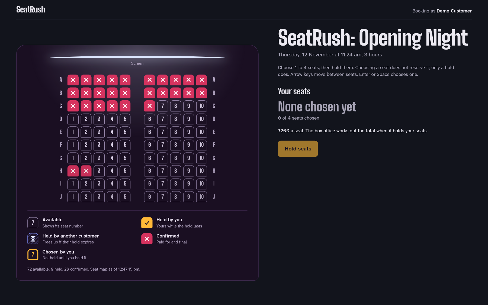

The application renders the hall state derived directly from PostgreSQL. Available seats are selectable; held seats display countdown rings; confirmed seats are locked with ticket stubs.

### Step 2: Multi-Seat Selection
The customer selects between 1 and 4 seats.


The client calculates nothing authoritative: it merely prepares the array of seat IDs. All pricing and quantity validation is deferred to the PostgreSQL function `claim_seats`.

### Step 3: Active Hold & Five-Minute Countdown
Upon clicking "Hold Selected Seats", the API executes `claim_seats` inside an idempotent lease.


- PostgreSQL assigns `created_at` and `expires_at = created_at + interval '5 minutes'`.
- The user sees a live 5-minute countdown clock.
- The user can explicitly release the hold at any time using the "Release Hold" button, which executes `release_hold` and returns the seats to the common pool.

### Step 4: Payment Simulation & Verification
When ready, the user selects a payment scenario from the panel:


The system supports 6 test scenarios:
1. **Instant Approval:** Immediate transition to `succeeded`.
2. **Instant Decline:** Immediate transition to `failed`.
3. **Delayed Success:** 10-second delay testing in-flight countdowns.
4. **Duplicate Delivery:** Simulates webhook redeliveries, verifying that duplicate webhooks return idempotent no-ops without double ticketing.
5. **Out-of-Order Webhook:** Webhook arrives before the HTTP response of payment initiation has completed.
6. **Delivery Failure:** Tests worker reconciliation sweeps.

### Step 5: Booking Confirmation & Ticket Issuance
Upon valid payment on an active hold, PostgreSQL executes `prepare_booking()` and `emit_booking()`:

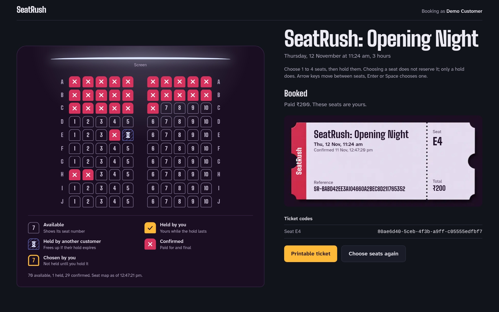

- A unique, cryptographically random booking reference is assigned (e.g. `SR-4B29A...`).
- Individual ticket codes are generated for each seat in `booked_seats`.
- A ticket-stub overlay appears on the seat map.
- The `booking.confirmed` event is committed to `domain_events`.

### Step 6: Dedicated Printable Ticket
The customer can navigate to `/bookings/[bookingId]` to view or print their immutable ticket:

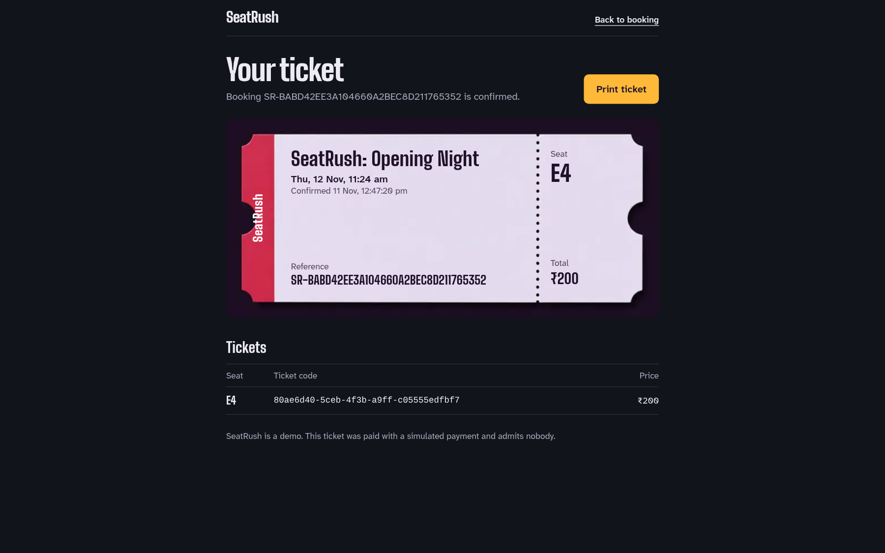

Because confirmed bookings and tickets are protected by the `reject_confirmed_change()` trigger, this record is permanently immutable on disk.

---

## Conclusion: The Laws of Systems Engineering in SeatRush

SeatRush demonstrates that building robust, high-concurrency systems is not about adding more caching layers or relying on probabilistic fallbacks. It is about **clarity of ownership, strict mathematical hierarchies, and leveraging the full relational power of the database**:

1. **PostgreSQL is the single source of truth:** Redis and queues are disposable wake-up mechanisms; they never decide inventory ownership.
2. **Never check-then-act in application memory:** Always use conditional database updates and pessimistic row locks.
3. **Prevent deadlocks with global total ordering:** Sort resources deterministically before acquiring locks.
4. **Defend invariants at the schema level:** Use `CHECK` constraints, temporal exclusion constraints (`EXCLUDE USING gist`), and deferred triggers.
5. **Make terminal states absorbing:** Final states cannot be overwritten.
6. **Eliminate dual-writes with transactional outbox:** State mutations and domain events must commit in the exact same database transaction.
7. **Fence distributed executions:** Use canonical hashing and fencing lease tokens to neutralize zombie processes and network partitions.
