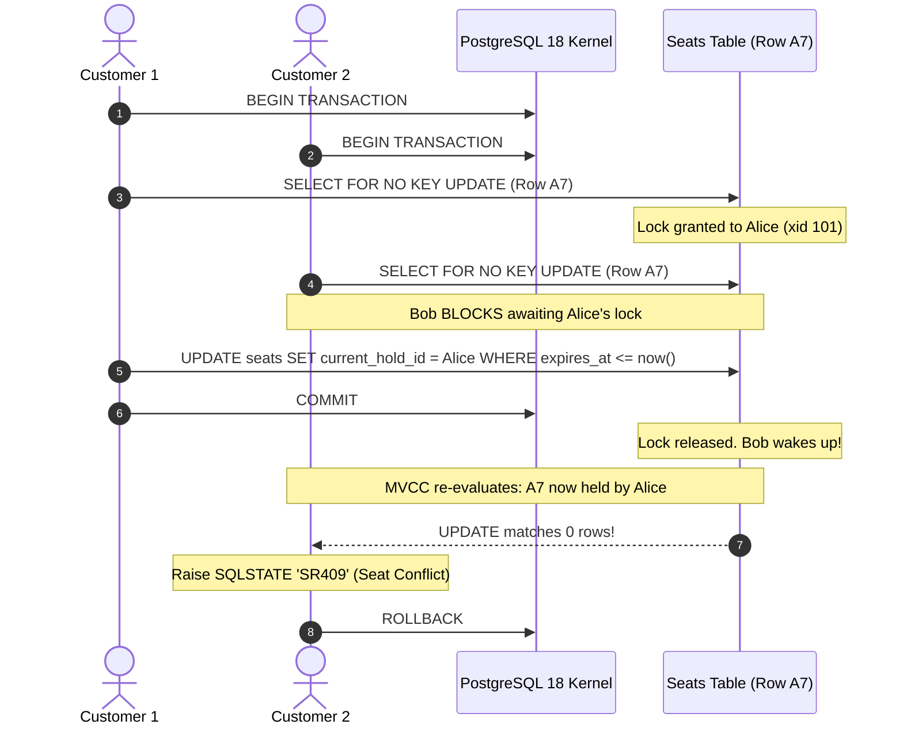
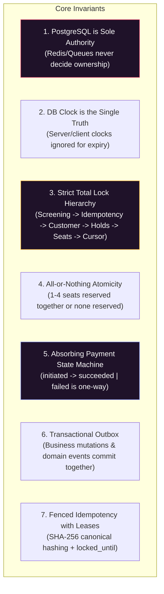
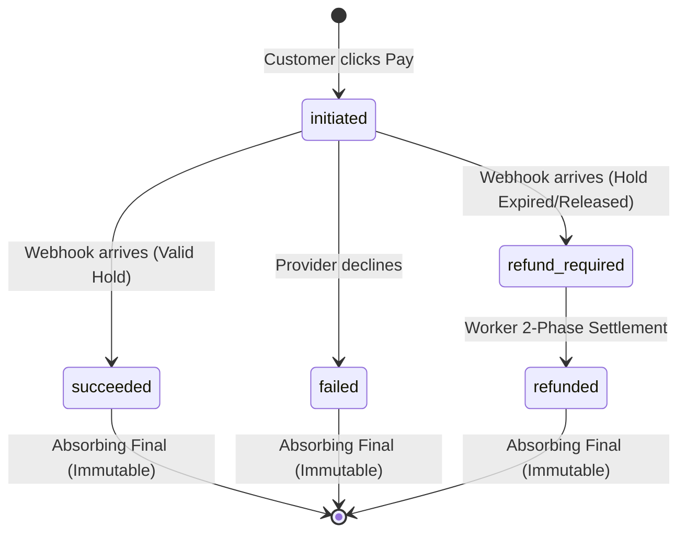
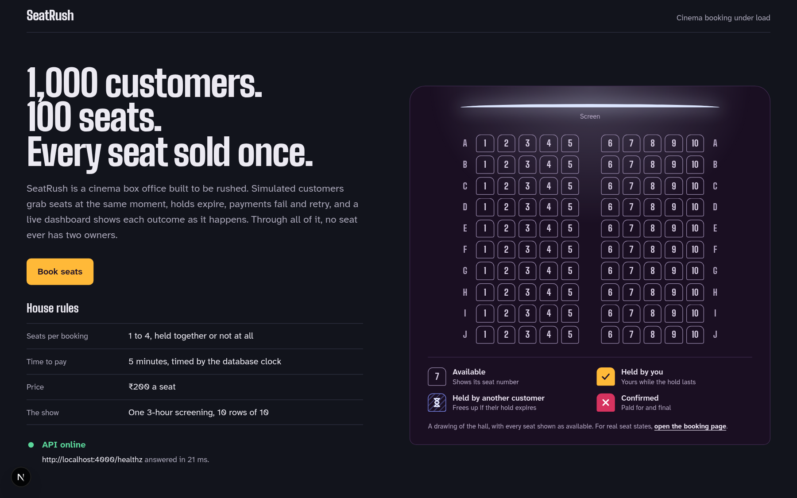
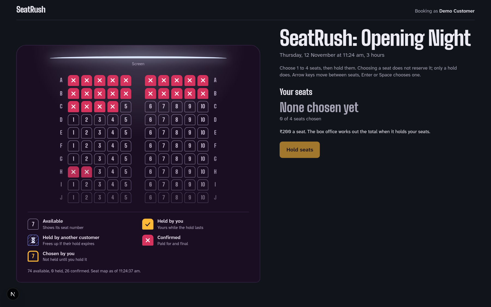
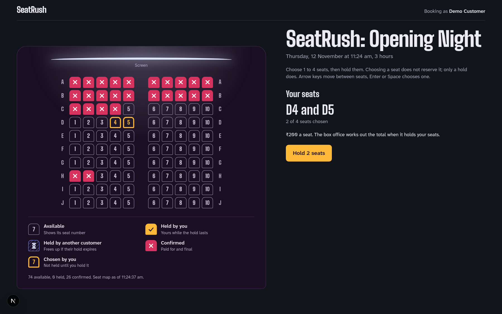
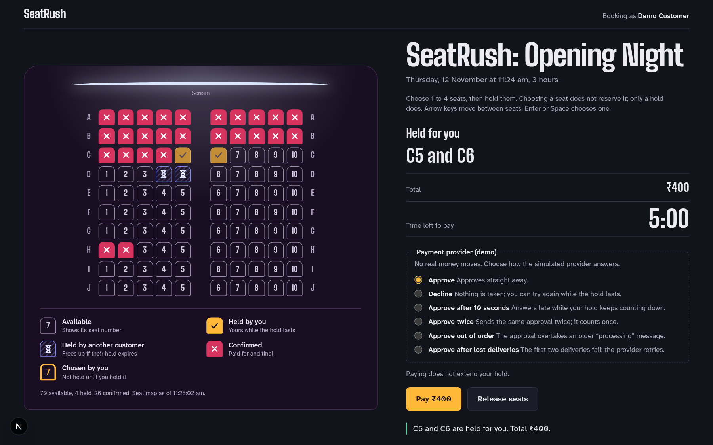
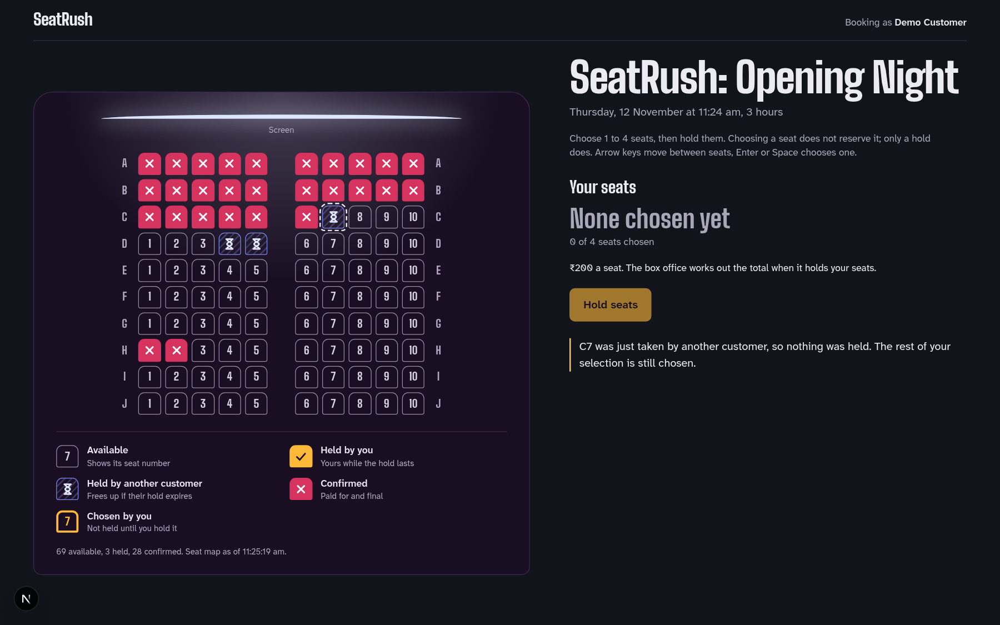
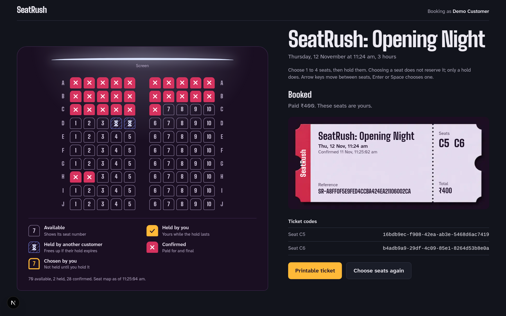
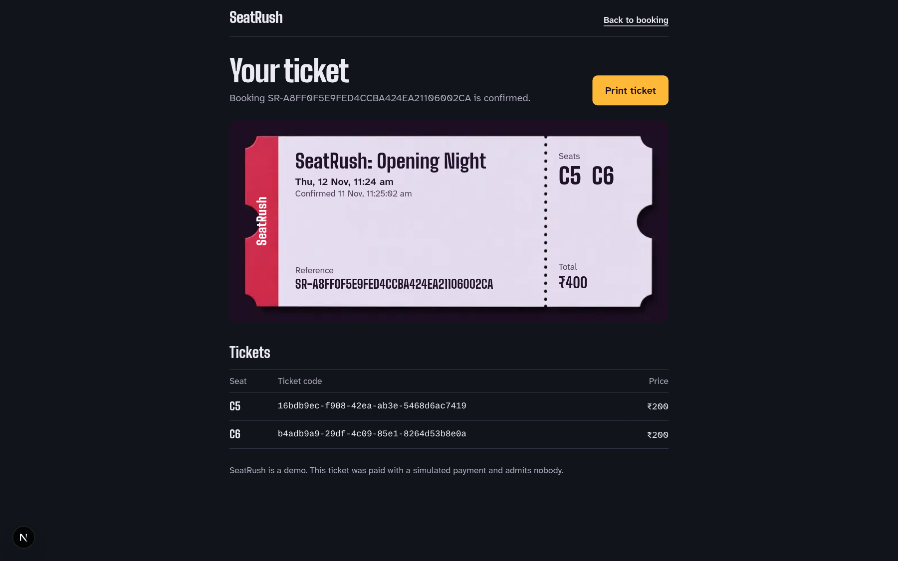

# Systems Programming Masterclass: The SeatRush Architecture & Engineering Manual

> **Welcome to the Engine Room.**  
> You might have "vibe-coded" this project with AI agents, but what runs in this repository is not magic or casual scripting. It is a battle-hardened, production-grade **high-contention distributed transactional system** built to survive the ultimate engineering nightmare: **1,000 concurrent customers fighting over 100 seats, with zero double-bookings, zero orphaned locks, and zero deadlocks.**

This manual breaks down the system from first principles, acting as your guide to mastering real-world systems programming, database concurrency, and distributed consistency.

---

## Table of Contents

1. [The Mental Model: The Anatomy of a High-Contention Race](#1-the-mental-model-the-anatomy-of-a-high-contention-race)
2. [The Seven Golden Invariants of SeatRush](#2-the-seven-golden-invariants-of-seatrush)
3. [System Topology & Monorepo Boundaries](#3-system-topology--monorepo-boundaries)
4. [Master Systems Curriculum: What SeatRush Teaches You](#4-master-systems-curriculum-what-seatrush-teaches-you)
5. [The Lifecycle of a Ticket: End-to-End Visual Guide](#5-the-lifecycle-of-a-ticket-end-to-end-visual-guide)
6. [Deep-Dive Documentation Index](#6-deep-dive-documentation-index)
7. [Hands-On Systems Lab: How to Inspect & Break the Engine](#7-hands-on-systems-lab-how-to-inspect--break-the-engine)

---

## 1. The Mental Model: The Anatomy of a High-Contention Race

Imagine a movie theater with 10 rows of 10 seats (100 seats total). At 12:00:00.000, tickets go on sale. 1,000 simulated users fire HTTP requests at the exact same millisecond. 50 of them pick seat **A7**.

In naive systems (and 90% of web apps), the code looks like this:

```typescript
// ❌ NAIVE CODE (DO NOT DO THIS IN PRODUCTION)
const seat = await db.seat.findUnique({ where: { id: "A7" } });
if (seat.status === "available") {
  // 💥 VULNERABILITY WINDOW (TOCTOU):
  // 49 other requests read 'available' before any of them write!
  await db.seat.update({ where: { id: "A7" }, data: { status: "held" } });
}
```

This is a **Time-of-Check to Time-of-Use (TOCTOU)** race condition. Under concurrency, all 50 threads read `status === 'available'`, all 50 pass the check, and all 50 issue an update. Seat A7 is promised to 50 people. When money gets taken, you have a PR disaster and financial liabilities.

### How SeatRush Solves It

SeatRush moves the entire decision into the database kernel using **deterministic pessimistic row locking** and **conditional atomic CTE execution**:



---

## 2. The Seven Golden Invariants of SeatRush

These rules are not suggestions; they are enforced at compile time, in schema DDL, and via database triggers. If code violates these rules, the database rolls back the transaction.



1. **PostgreSQL is the Sole Authority**: Redis and BullMQ queues are transient messengers. If Redis is flushed mid-simulation, not a single seat assignment or payment state is corrupted.
2. **The Database Clock Decides Expiry**: Expiry is evaluated as `expires_at <= now()` *inside* the deciding SQL query. App-server clocks can drift by minutes without compromising safety.
3. **Deadlock-Free Resource Hierarchy**: All multi-resource locks are acquired in strict lexicographical UUID order. It is mathematically impossible for circular wait conditions (deadlocks) to form.
4. **All-or-Nothing Atomicity**: A family requesting 4 seats will never be partially allocated 3 seats. If seat 4 is taken, all 4 remain untouched.
5. **Absorbing Terminal States**: Once a payment attempt transitions to `succeeded` or `failed`, database triggers prevent any further update. Late success notifications on expired holds automatically trigger refunds instead of overwriting inventory.
6. **Transactional Outbox & Gapless Cursors**: Every state change inserts an event into `domain_events` in the *exact same transaction*. A dedicated row lock on `screening_event_cursors` guarantees that event IDs match the exact order transactions commit to disk.
7. **Lease-Fenced Idempotency**: Duplicate requests within 30 seconds are fenced. Network retries reuse cached responses; payload tampering under the same key is rejected with `409 Conflict`.

---

## 3. System Topology & Monorepo Boundaries

```mermaid
flowchart TB
    subgraph Browser ["Client Surface"]
        direction TB
        UI["Next.js 16 App Router<br/>(Port 3000)"]
    end

    subgraph API_Layer ["API & Ingestion Surface"]
        API["Express 5 REST API<br/>(Port 4000)"]
        AUTH["HMAC-SHA256 Token Validator"]
        IDEM["Idempotency Engine & Request Hasher"]
        CONF["100ms Conflict Aggregator"]
    end

    subgraph Persistence ["Authoritative State Engine"]
        PG[("PostgreSQL 18<br/>(Host Port 5433)")]
        subgraph Tables ["Database Core"]
            SEATS["seats (Current Owner)"]
            HOLDS["holds (5-min Leases)"]
            BOOKINGS["bookings & booked_seats"]
            PAYMENTS["payment_attempts & events"]
            OUTBOX["domain_events & cursors"]
            IDEM_TAB["idempotency_records"]
        end
    end

    subgraph Messaging ["Background Workers & Queues"]
        REDIS[("Redis 8<br/>(Host Port 6379)")]
        WORKER["BullMQ Worker Daemon"]
        SWEEPS["30s Reconciliation Loops"]
    end

    UI -->|REST + Bearer Token| API
    API --> AUTH --> IDEM
    IDEM -->|SELECT ... FOR NO KEY UPDATE| PG
    API -->|Enqueue Delayed Jobs| REDIS
    API -.->|Pub/Sub Conflict Windows| REDIS
    REDIS -->|Consume Jobs| WORKER
    WORKER -->|cleanup_expired_hold()| PG
    WORKER -->|completeRefund()| PG
    SWEEPS -.->|Heal Lost Redis Jobs| PG
```

### Clean Architecture Seams

The project enforces clean separation across four discrete layers:

| Package / App | Responsibility | Boundary Rule |
|---|---|---|
| `packages/shared` | Zod request/response schemas, domain constants, event schemas, server-only crypto helpers (`@seatrush/shared/server`). | **Zero I/O.** Pure TypeScript definitions imported by API, Worker, and Web. |
| `packages/db` | Prisma schema, SQL migrations, stored procedures (`claim_seats`, `release_hold`, `cleanup_expired_hold`), client factory, and invariant engine. | Encapsulates all SQL and row-locking logic. Exposes clean transactional functions. |
| `apps/api` | Express 5 HTTP routes, token issuance, idempotency middleware, route validation, and error classification. | Pure HTTP coordinator. Does not decide business logic; calls `packages/db`. |
| `apps/worker` | BullMQ worker consuming 4 queues (`hold-expiry`, `payment-events`, `refunds`, `payment-reconciliation`). | Background task runner. Decoupled from HTTP request lifecycle; contains 30s self-healing sweeps. |
| `apps/web` | Next.js 16 customer booking UI (`/book`), ticket confirmation, and printable views. | Progressive enhancement. Accessible DOM first, honest reflection of backend truth. |

---

## 4. Master Systems Curriculum: What SeatRush Teaches You

SeatRush was crafted to demonstrate the core tenets of systems programming in high-throughput transactional environments.

### 1. Concurrency Control: Why Row Locking Beats Serializable Under Load
When 1,000 customers contest 100 seats, setting your transaction isolation to `SERIALIZABLE` causes **Serializable Snapshot Isolation (SSI)** abort storms. PostgreSQL detects read/write anti-dependencies and terminates transactions with SQLSTATE `40001` (`serialization_failure`), forcing complex exponential backoffs that overwhelm the CPU.

SeatRush demonstrates the superior pattern for inventory systems: **Read Committed isolation level combined with explicit, deterministic pessimistic row locks** (`FOR NO KEY UPDATE`).

👉 *Read full analysis:* [`docs/SYSTEMS_CONCURRENCY_DEEP_DIVE.md` (Section 2)](#6-deep-dive-documentation-index)

### 2. Deadlock Avoidance: Total Resource Ordering
If Transaction 1 locks Seat 5 then Seat 6, while Transaction 2 locks Seat 6 then Seat 5, PostgreSQL halts both and throws `40P01` (`deadlock_detected`), killing one transaction.

SeatRush demonstrates **Total Resource Ordering**:
Every SQL procedure sorting multi-seat operations enforces deterministic UUID sorting (`ORDER BY id ASC`). Combined with a strict global lock ladder (`screening -> idempotency -> customer -> holds -> seats -> cursor`), deadlocks are mathematically eliminated.

👉 *Read full analysis:* [`docs/SYSTEMS_CONCURRENCY_DEEP_DIVE.md` (Section 3)](#6-deep-dive-documentation-index)

### 3. Absorbing State Machines in Distributed Payments
In real-world payment processing, network delays cause webhooks to arrive out of order, duplicate, or arrive after a customer abandoned checkout.
SeatRush models payment attempts as an **absorbing state machine**:



Once in `succeeded` or `failed`, the state can *never* move backwards. If a `processing` notice arrives late after `succeeded`, it is safely ignored.

👉 *Read full analysis:* [`docs/SYSTEMS_CONCURRENCY_DEEP_DIVE.md` (Section 6)](#6-deep-dive-documentation-index)

### 4. The Sequence Cursor Pattern: Solving the Commit-Order Inversion Hazard
In high-throughput systems, using a PostgreSQL `BIGSERIAL` sequence for events has a subtle race condition:
Transaction A gets sequence ID 101. Transaction B gets sequence ID 102. Transaction B commits instantly. Transaction A takes 50ms to commit.
A client asking for `SELECT * FROM events WHERE id > 100` at millisecond 10 sees event 102 and stores cursor `102`. When Transaction A commits event 101 later, **the client never sees event 101!**

SeatRush implements the **Sequence Cursor Pattern**: A dedicated row lock on `screening_event_cursors` is taken as the final lock in every transaction, forcing transactions to commit in strict sequence order.

👉 *Read full analysis:* [`docs/SYSTEMS_CONCURRENCY_DEEP_DIVE.md` (Section 7)](#6-deep-dive-documentation-index)

### 5. Self-Healing Background Architecture ("Belt and Suspenders")
Never trust a message broker alone with critical state. If Redis restarts or drops jobs during an ungraceful failover, an expiry job is lost.
SeatRush pairs event-driven BullMQ jobs (the *Belt*) with a 30-second database reconciliation sweep (the *Suspenders*). If an expiry or refund job is dropped, the sweep queries `holds WHERE status = 'active' AND expires_at <= now()` and reconciles state automatically.

👉 *Read full analysis:* [`docs/ARCHITECTURE_AND_USER_GUIDE.md` (Section 3)](#6-deep-dive-documentation-index)

---

## 5. The Lifecycle of a Ticket: End-to-End Visual Guide

Here is how the system looks and operates at every step of the customer journey, backed by the real screens in the application:

### Step 1: The Landing Page & Health Ingestion
Users land on the home screen. A React Server Component tests `/healthz` and verifies database and Redis connectivity with latency readouts.



---

### Step 2: The Interactive Seat Map
Navigating to `/book` auto-provisions a secure, stateless customer identity via `POST /auth/demo-session` (signed with HMAC-SHA256). The 100-seat auditorium is rendered as an accessible DOM grid.



---

### Step 3: Local Selection (Zero Hoarding Hazard)
Selecting seats (1 to 4) is tracked purely in client-side React state. The backend is not touched. This prevents malicious clients from hoarding inventory simply by clicking buttons.



---

### Step 4: The Atomic Hold (5-Minute Guarantee)
The user clicks "Hold 2 seats". The API runs `claim_seats` in Postgres, acquiring row locks on the requested seats. Upon success, an exact 5-minute countdown starts, synchronized against the database's `serverTime`.



---

### Step 5: Testing Payment Resilience (The 6 Provider Scenarios)
The user selects how the simulated payment provider should behave. This allows developers to test network partitions, duplicate deliveries, and delayed timeouts on demand.


---

### Step 6: Handling High-Contention Conflicts (409)
If a competing customer claims a seat while you are choosing it, the atomic update rejects the claim with `409 Conflict`. The UI marks the contested seat with a dashed outline while preserving your remaining selections.



---

### Step 7: Booking Confirmation & Ticket Stub
When payment succeeds on a valid hold, the atomic booking transaction confirms ownership, generates a unique booking reference (`SR-...`) and ticket codes, and renders an overlaid ticket stub.



---

### Step 8: Dedicated Printable Ticket
The customer can view their ticket at `/bookings/[bookingId]`. When printed or saved to PDF, the stylesheet automatically switches to clean black-and-white print media formatting.



---

## 6. Deep-Dive Documentation Index

To explore the exact implementation details, code snippets, and failure proofs:

| Document | Focus | What's Inside |
|---|---|---|
| 📖 **[Systems & Concurrency Deep Dive](SYSTEMS_CONCURRENCY_DEEP_DIVE.md)** | **Database Internals & Systems Logic** | MVCC, Lock Modes (`FOR NO KEY UPDATE`), Total Resource Ordering, Stored Procedures (`claim_seats`), State Machine Guards, Transactional Outbox, Idempotency Leases. |
| 📖 **[Architecture & Visual User Guide](ARCHITECTURE_AND_USER_GUIDE.md)** | **Component Architecture & Operations** | Full topology diagrams, Monorepo package seams, Walkthrough of all 8 screens, Worker sweeps, Resilience analysis, and Verification cheatsheet. |
| 📑 **[ADR 0001: Seat Ownership in Postgres](adr/0001-seat-ownership-in-postgres.md)** | **Architecture Decision Record** | Mathematical proof of lock hierarchies, why Serializable was rejected, and why PostgreSQL is the sole authority. |
| 📑 **[ADR 0002: Demo Customer Tokens](adr/0002-demo-customer-tokens.md)** | **Architecture Decision Record** | Stateless HMAC-SHA256 session tokens, rate limiting per IP, and owner-scoped authorization. |
| 📑 **[ADR 0003: Payment Simulator Trust](adr/0003-payment-simulator-and-notification-trust.md)** | **Architecture Decision Record** | Raw-body webhook signatures, deterministic provider event IDs, and absorbing state handling. |

---

## 7. Hands-On Systems Lab: How to Inspect & Break the Engine

Want to verify these systems principles for yourself? Run these commands in your terminal:

### 1. Inspect Live Inventory Partitioning
Connect to PostgreSQL and verify that all 100 seats partition cleanly without overlaps:

```bash
PGPASSWORD=seatrush psql -h localhost -p 5433 -U seatrush -d seatrush -c "
SELECT 
  (SELECT count(*) FROM seats WHERE current_hold_id IS NULL AND id NOT IN (SELECT seat_id FROM booked_seats)) AS available,
  (SELECT count(*) FROM holds WHERE status = 'active' AND expires_at > now()) AS active_holds,
  (SELECT count(*) FROM booked_seats) AS confirmed_tickets;
"
```

### 2. Fire 50 Concurrent Claims at a Single Seat (The Thundering Herd)
Run the automated Vitest concurrency test to watch 50 parallel requests hit seat A7 simultaneously:

```bash
pnpm --filter @seatrush/api test tests/booking.integration.test.ts -t "simultaneous hold"
```
*Expected Result:* Exactly **1** request succeeds (`201 Created`), and **49** requests are rejected (`409 Conflict`). Zero deadlocks.

### 3. Run the Database Invariant Verifier
Verify all 12 core mathematical invariants across the entire database:

```bash
pnpm --filter @seatrush/db test tests/invariants.test.ts
```

---

*SeatRush: Built with rigor. Proven under concurrency. Grounded in PostgreSQL truth.*
